# File Vault walkthrough

File Vault stores encrypted documents for your local portal account. Your
browser encrypts file contents, filenames and media types before upload, and
decrypts authorized files when downloading. The server stores ciphertext and
encrypted keys. Your portal password signs you in; a separate **recovery key**
unlocks your file encryption keys.

The app is embedded in **caddy-security v1.6.2 / go-authcrunch v1.5.0** at
`/auth/documents/` for a portal mounted at `/auth`. Follow the
[local application setup](portal-apps.md) to enable the Documents API and
configure its database, public HTTPS origin, mount and local realm. Sign in
with a current local browser login and `authp/user` or `authp/admin`.
Administrator status does not grant access to other people's files.

The screenshots below come from the supplied **AuthCrunch UI v1.1.4** File Vault
demo, captured October 27, 2026 with real Caddy/AuthCrunch and disposable
accounts. Its portal is `/xauth`, so replace that prefix with your configured
mount, such as `/auth`. UI, integration and library versions are separate.
The supplied report records all eight journeys passing on desktop and mobile;
screens from different journeys use independent accounts and storage.

## 1. Sign in and find your way around

Open **File Vault** from the portal. A first visit shows **Set up your vault**.
The sidebar contains **Library**, **Shared with me**, **Upload document**, and
**Vault**. The avatar menu contains **Preferences**, **Diagnostics**, **Portal**,
and **Sign out**. Use the sidebar toggle for a compact desktop rail or the
navigation drawer on a phone.

<figure className="doc-screenshot">

[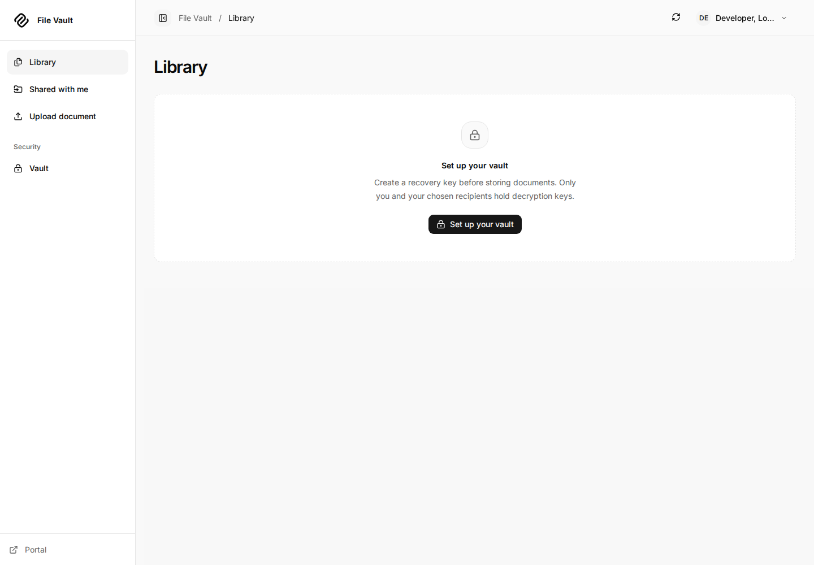](images/file-vault/first-visit.png)

<figcaption>Signing into the portal establishes account access; the separate vault must still be enrolled and unlocked.</figcaption>
</figure>

<details className="screenshot-gallery">
<summary>Portal sign-in, account menu and mobile navigation</summary>

<figure className="doc-screenshot">

[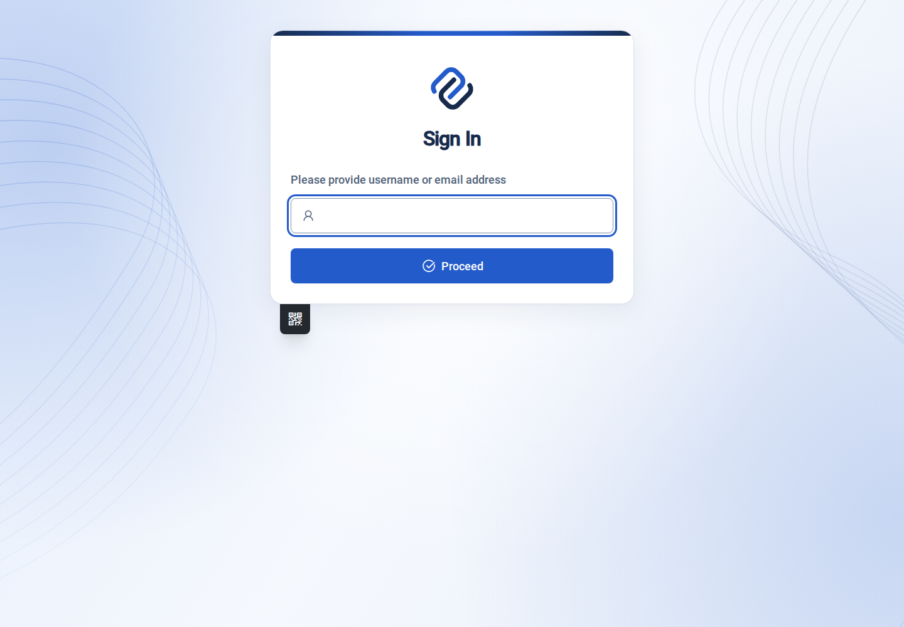](images/file-vault/sign-in.png)

<figcaption>Complete the portal's configured login and MFA flow before using the app.</figcaption>
</figure>

<figure className="doc-screenshot">

[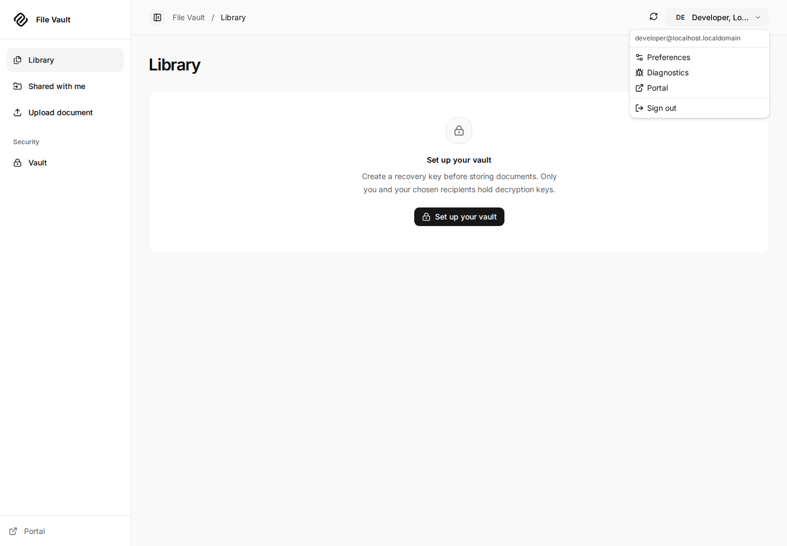](images/file-vault/account-menu.png)

<figcaption>Preferences and Diagnostics are in the account menu.</figcaption>
</figure>

<figure className="doc-screenshot">

[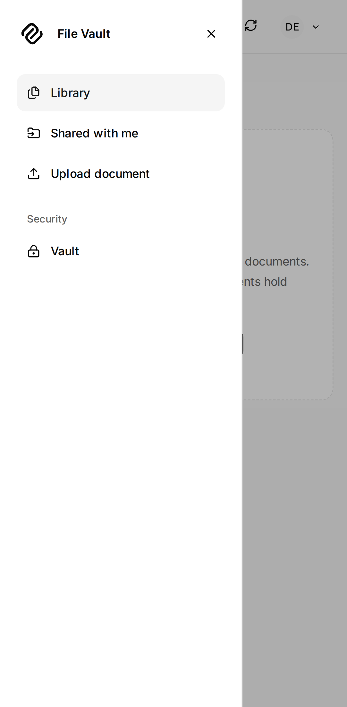](images/file-vault/mobile-navigation.png)

<figcaption>The phone drawer exposes the same file and vault destinations.</figcaption>
</figure>

<figure className="doc-screenshot">

[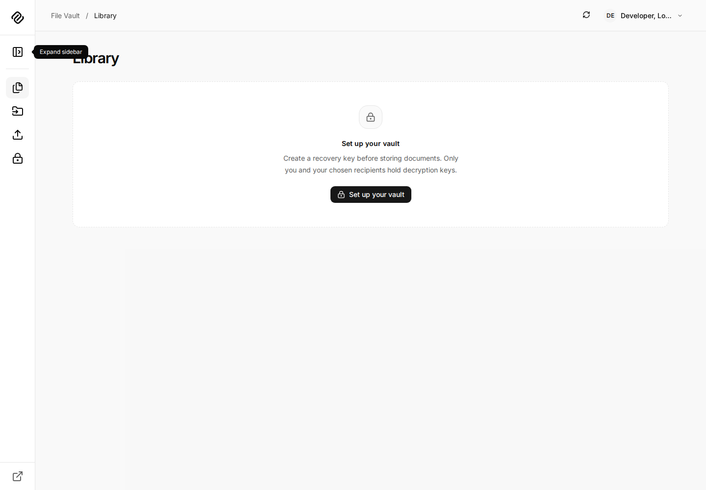](images/file-vault/collapsed-sidebar.png)

<figcaption>The desktop rail preserves navigation while leaving more room for document details.</figcaption>
</figure>

</details>

## 2. Generate and save a recovery key

1. Open **Vault** or select **Set up your vault**.
2. Choose **Generate recovery key**. The browser creates a random secret;
   it is independent of your login password.
3. Choose **Download recovery file** and keep the file somewhere private and
   recoverable outside this vault. You may also reveal/copy the recovery key
   into a trusted password manager.
4. Select **I have saved my recovery key in a safe place**.
5. Choose **Enroll vault**. Once registration succeeds, unlock with the saved
   key if the app asks. Confirm that the vault shows **Vault unlocked**.

<figure className="doc-screenshot">

[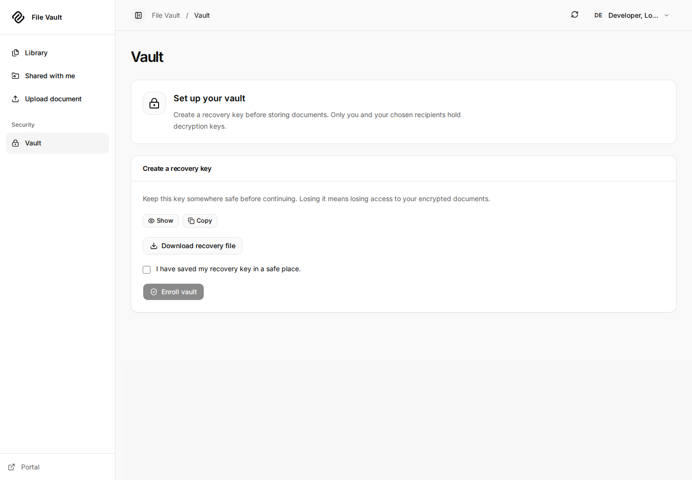](images/file-vault/save-recovery.png)

<figcaption>Save the recovery material before acknowledging the backup and registering the vault.</figcaption>
</figure>

The recovery file contains a secret as well as portal/account/key bindings.
Do not send it to a recipient or administrator. Losing every usable copy of
the recovery key removes your ability to unlock the encrypted private keys.
The server cannot recover plaintext from your login password.

After enrollment, the Vault page shows your **User ID**, **Fingerprint**,
**Your share code**, and storage limits. The share code is public identity
information, suitable for giving a sender; it is distinct from the secret
recovery key. The app's compact format is `User-ID:Fingerprint`.

<details className="screenshot-gallery">
<summary>Unlocked identity and storage limits</summary>

<figure className="doc-screenshot">

[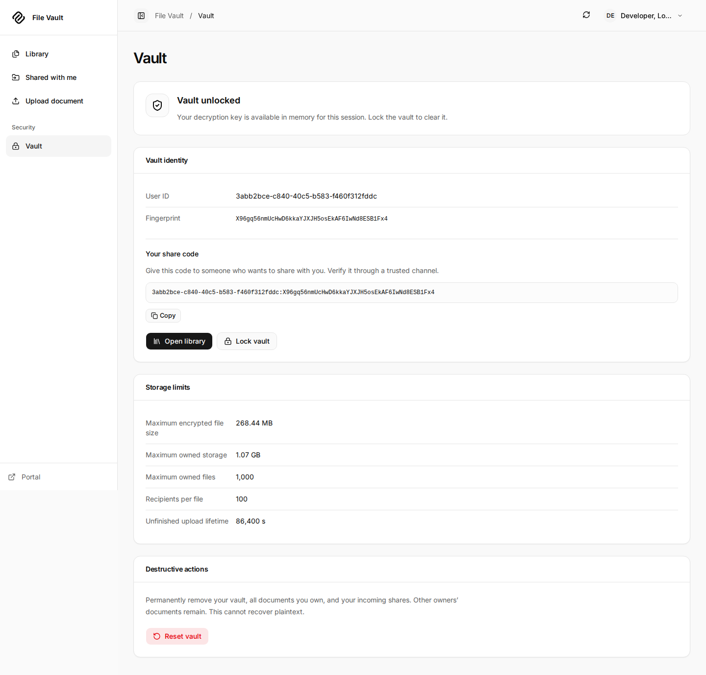](images/file-vault/vault-unlocked.png)

<figcaption>Share only the public identity code. The recovery key is never part of a sharing grant.</figcaption>
</figure>

</details>

## 3. Encrypt and upload a file

Open **Upload document**, select a local file and inspect its name and size.
Choose **Upload document** to encrypt and transfer it. Wait for completion
before closing the page. Use **View document** to inspect the finished file,
or **Open library** to return to your collection.

<figure className="doc-screenshot">

[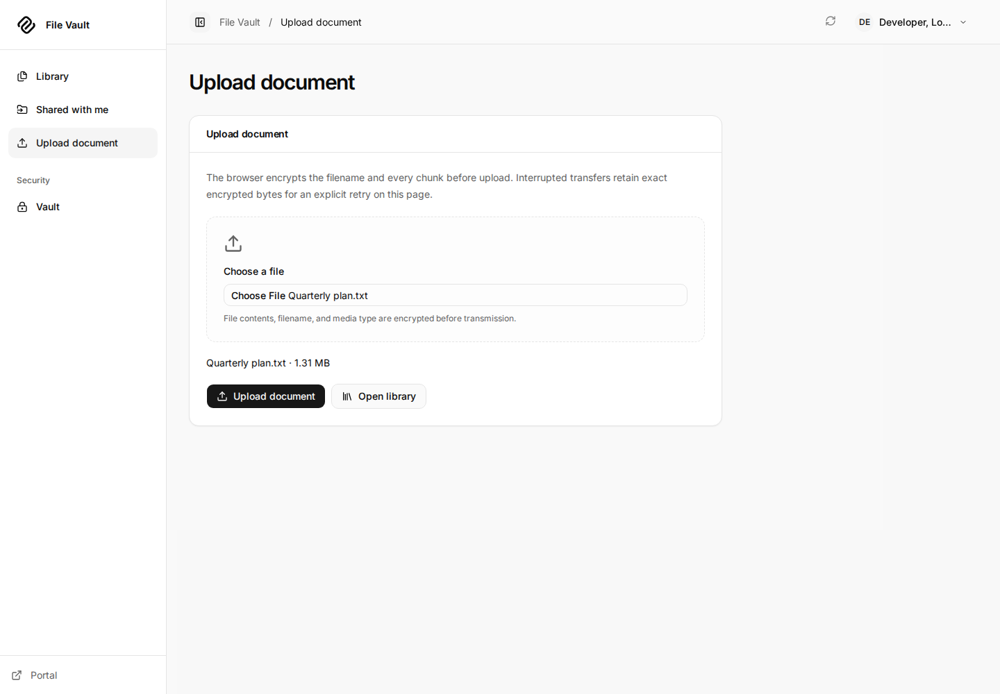](images/file-vault/select-file.png)

<figcaption>Selecting a file precedes the upload action. The demo uses a disposable text file.</figcaption>
</figure>

The browser encrypts the metadata and each chunk before sending it. The server
first reserves space; it makes the upload ready after all chunks have arrived
and the client commits it. A pending reservation is not a completed file.
The demo's 1.31 MB input spans two plaintext chunks; encrypted storage includes
authentication tags, so original size and encrypted size need not be equal.

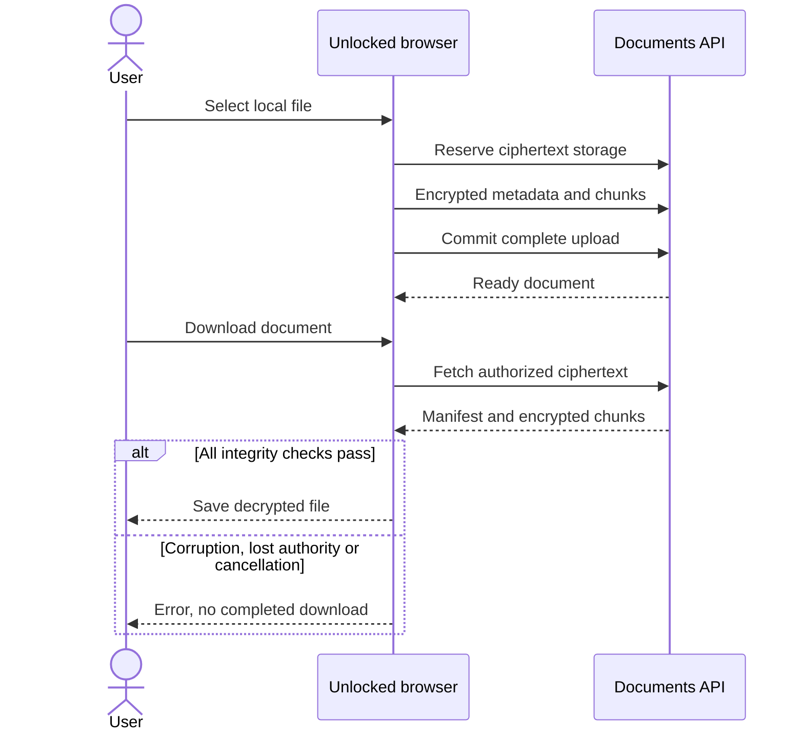

<details className="screenshot-gallery">
<summary>Completed transfer and authenticated document details</summary>

<figure className="doc-screenshot">

[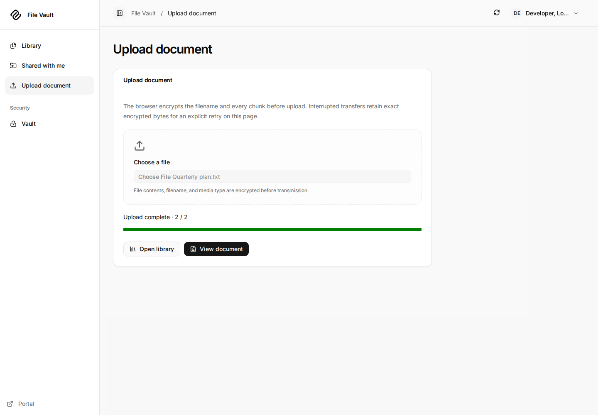](images/file-vault/upload-completed.png)

<figcaption>The completion state appears after the upload commits.</figcaption>
</figure>

<figure className="doc-screenshot">

[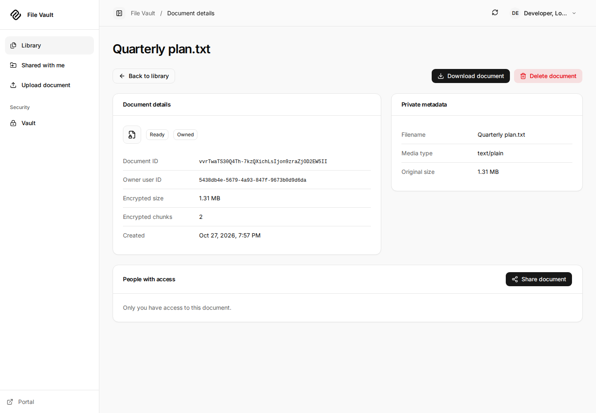](images/file-vault/document-details.png)

<figcaption>The owner can inspect authenticated metadata, download, share, or delete the file.</figcaption>
</figure>

</details>

If a transfer is interrupted, keep the original local file. **Retry** can resend
the retained encrypted chunk state while that upload page is still available.
After a lost allocation response or a reload, inspect Library for a pending
reservation before starting over; the client cannot assume an uncertain
allocation failed. Remove an unwanted pending entry or let the server's upload
lifetime expire. Activity does not extend that lifetime.

Storage limits apply to encrypted bytes, including pending reservations. Read
the limits shown on **Vault**; defaults include a 256 MiB encrypted file limit,
1 GiB owned storage and a 24-hour pending upload lifetime. The UI formats sizes
for readability. A quota failure does not delete your local original.

## 4. Browse, search and download

**Library** shows files available on the current page. Unlocking lets the
browser retrieve and decrypt their names; locking or reloading replaces private
filenames with encrypted-document placeholders. The search field and counts
apply to the **current page**, not the entire server collection. Use **Next**
and **Previous** for other pages; **Shared with me** filters received files
within the current page of results.

An empty search result does not establish that the account has no documents.
Clear the query, change the page, or upload a file. Open a ready document and
choose **Download document**. The browser authenticates its metadata and every
chunk before offering the decrypted download. Save it locally and, for a
practice run, compare it with the original. The supplied demo verified the
downloaded bytes against the source file.

<details className="screenshot-gallery">
<summary>Search with no match and Library after a reload</summary>

<figure className="doc-screenshot">

[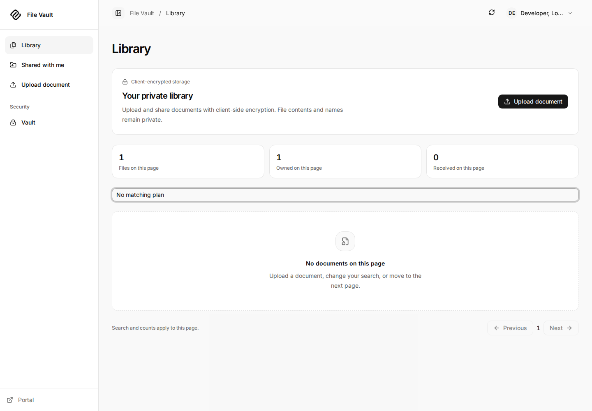](images/file-vault/search-empty.png)

<figcaption>Clear the page's query before concluding that a file is absent.</figcaption>
</figure>

<figure className="doc-screenshot">

[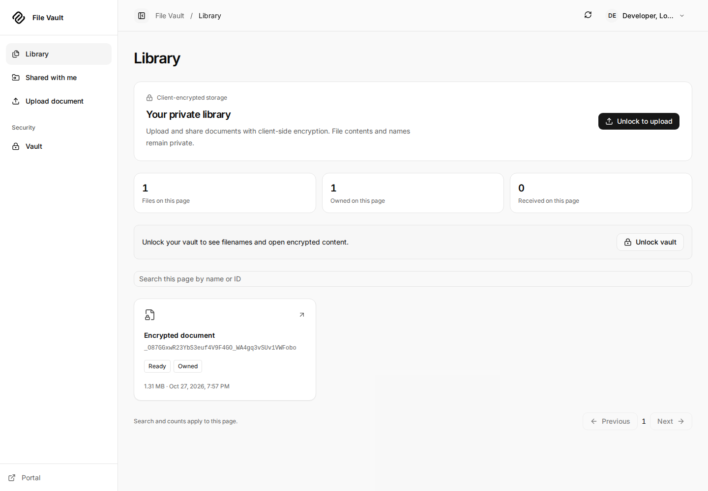](images/file-vault/library-locked.png)

<figcaption>Reloading drops the in-memory decryption key. Files remain on the server.</figcaption>
</figure>

</details>

## 5. Verify a recipient and grant access

Use two distinct accounts in separate browser profiles/windows. In the local
setup Alice can own the file and Bob can receive it. The supplied demo instead
uses `developer` as owner and `admin` as recipient: the administrator receives
access through a normal grant, not an administrative override.

1. The recipient signs in, enrolls their own vault, saves their own recovery
   key, and copies **Your share code** from **Vault**.
2. Exchange that public code through an independently trusted channel. Confirm
   it belongs to the person and portal you intended.
3. The owner unlocks their vault, opens the uploaded document and chooses
   **Share document**.
4. Paste the recipient's code and choose **Verify recipient**. The app looks
   up the recipient's current public key and checks the full fingerprint.
5. Compare the displayed identity/fingerprint with the independently obtained
   code. Select the verification acknowledgement, then **Grant access**.
6. Confirm the recipient appears under **People with access**.

<figure className="doc-screenshot">

[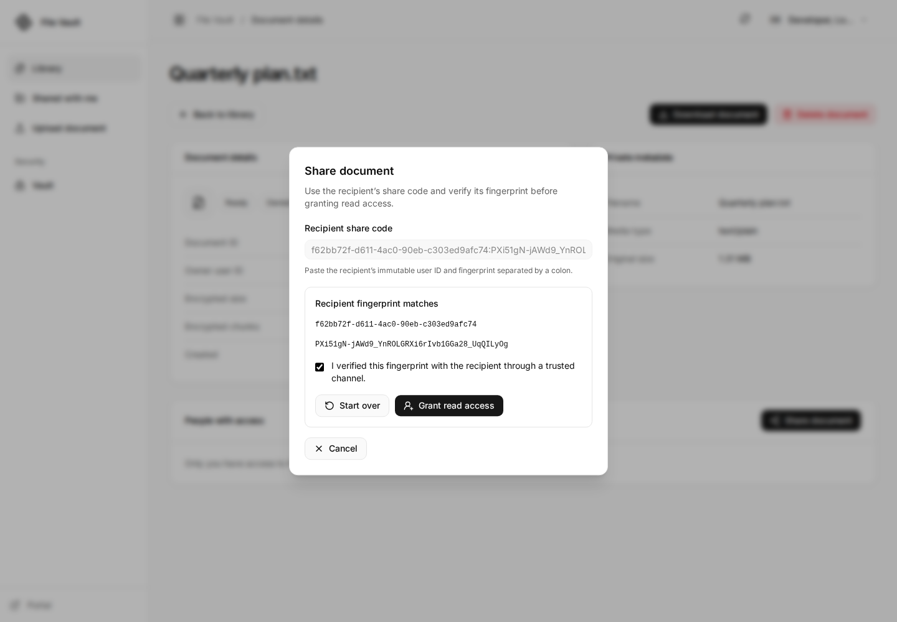](images/file-vault/verify-recipient.png)

<figcaption>Key lookup and a trusted identity check precede the explicit grant.</figcaption>
</figure>

The browser wraps the document key for that recipient; it does not send them
your recovery key or private key. A changed fingerprint requires a newly
verified code. Sharing is account-bound; this app does not create public
download links or search for recipients by email.

<details className="screenshot-gallery">
<summary>Owner's active sharing grant</summary>

<figure className="doc-screenshot">

[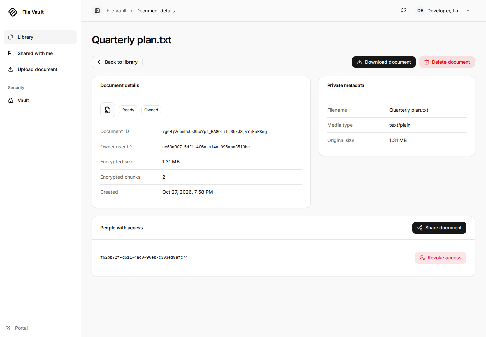](images/file-vault/active-share.png)

<figcaption>The owner can review and revoke individual recipient grants.</figcaption>
</figure>

</details>

## 6. Receive and download the shared file

In the recipient's browser, unlock their own vault and open **Shared with me**.
Open the received document and use **Download document**. The recipient decrypts
with their own key; the file remains owned by the sender. Received-file details
offer no owner sharing, revocation or deletion controls.

<figure className="doc-screenshot">

[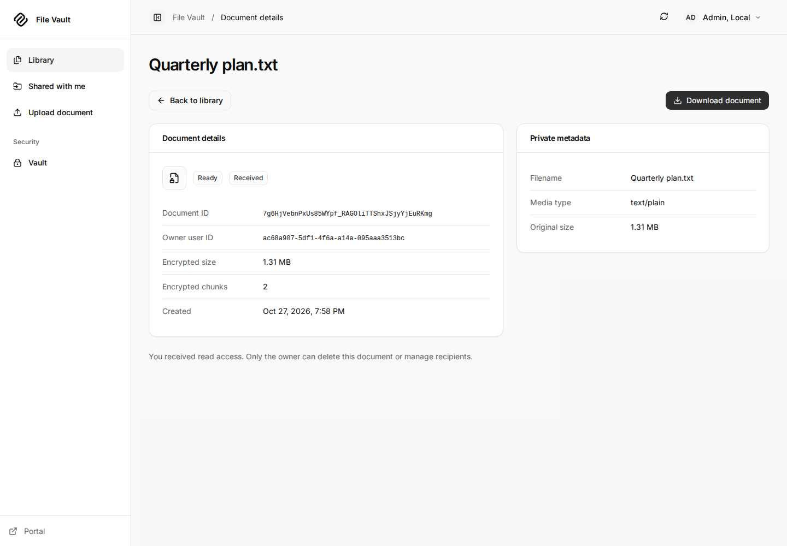](images/file-vault/recipient-view.png)

<figcaption>The recipient can read the granted file. The owner retains grant and deletion control.</figcaption>
</figure>

## 7. Revoke a grant and delete a document

Back in the owner's browser, choose **Revoke access** for the recipient and
confirm the dialog. Check that the grant disappears. Future server fetches
for that recipient are denied. Revocation cannot erase plaintext or keys the
recipient already downloaded or copied.

To remove the owned file itself, choose **Delete document** and confirm the
specific target. The file leaves your library and is no longer available for
future recipient fetches. Keep a local backup if you need it: server deletion
does not provide an undo or restore workflow.

<details className="screenshot-gallery">
<summary>Revocation, deletion and their completed states</summary>

<figure className="doc-screenshot">

[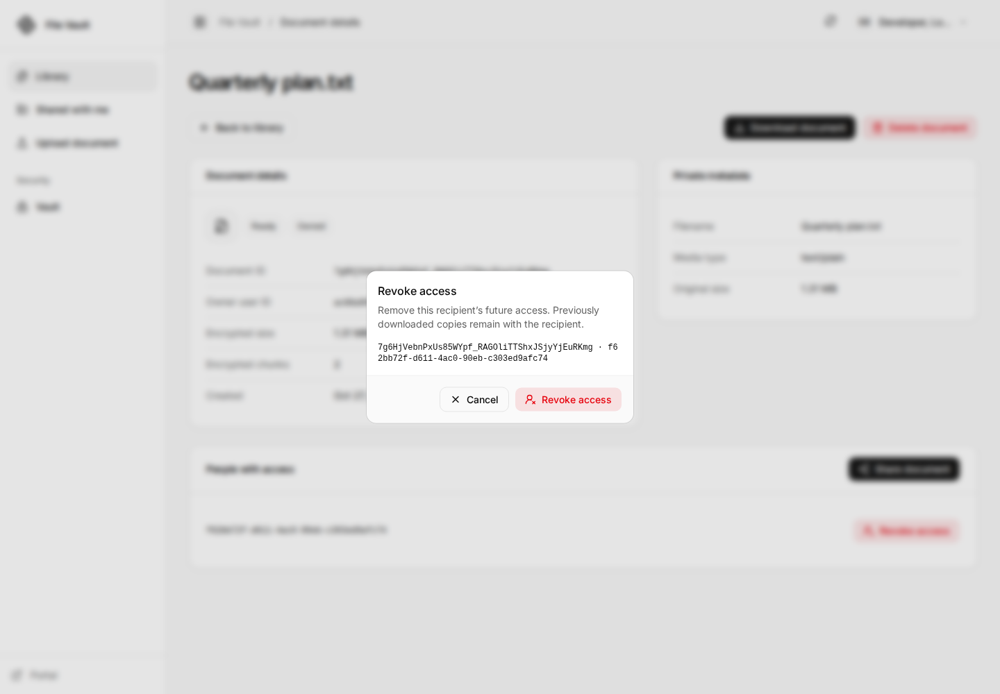](images/file-vault/revoke-confirmation.png)

<figcaption>Confirm the recipient before removing a grant.</figcaption>
</figure>

<figure className="doc-screenshot">

[](images/file-vault/share-revoked.png)

<figcaption>The removed grant no longer appears under People with access.</figcaption>
</figure>

<figure className="doc-screenshot">

[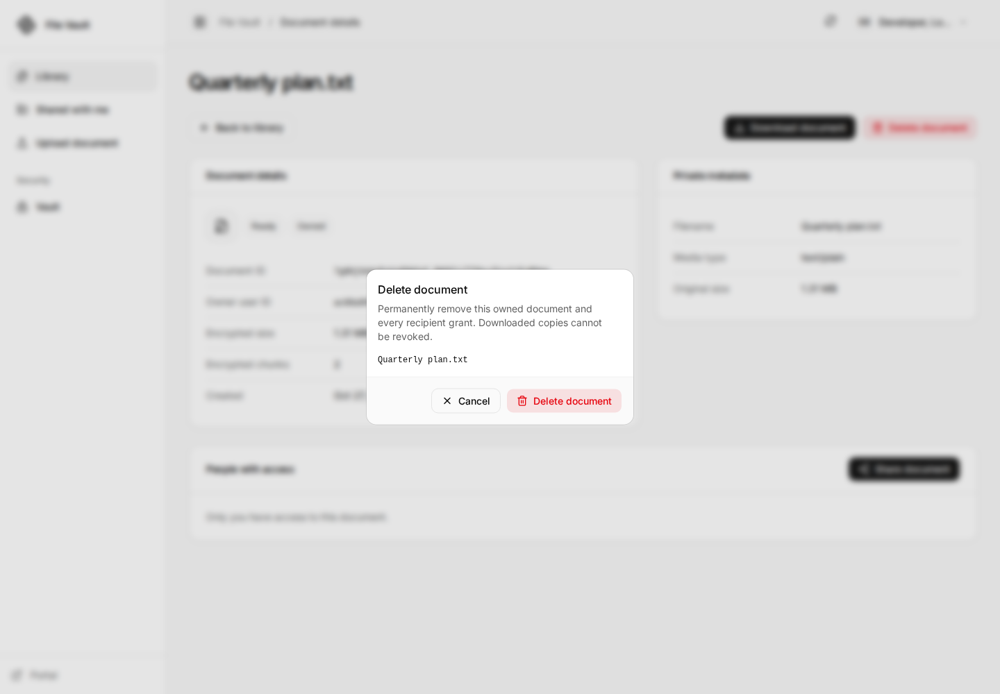](images/file-vault/delete-confirmation.png)

<figcaption>Deleting the document is separate from revoking one recipient.</figcaption>
</figure>

<figure className="doc-screenshot">

[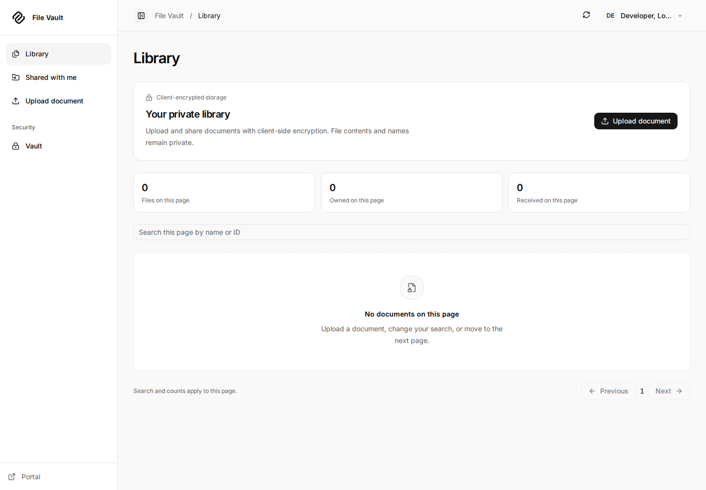](images/file-vault/document-deleted.png)

<figcaption>The completed deletion returns the owner to the library.</figcaption>
</figure>

</details>

## 8. Lock, recover and reset

Choose **Lock vault** to drop this app's in-memory decryption access. This
does not delete server files or end the portal login. A page reload or fresh
app session also requires unlocking again. To recover access, open **Vault**,
paste the saved recovery key or choose **Import recovery file**, then select
**Unlock vault**. Import is local; the recovery secret is not uploaded.
The file must match the portal, account and registered key fingerprint.

<figure className="doc-screenshot">

[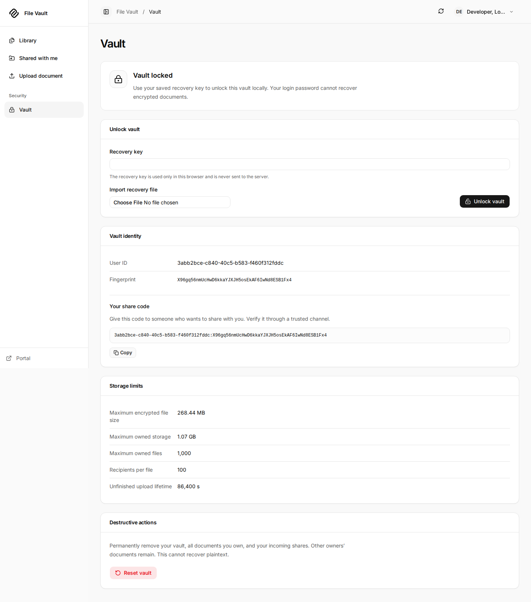](images/file-vault/vault-locked.png)

<figcaption>Unlock with the matching saved material after a reload or on another browser.</figcaption>
</figure>

**Reset vault** is a destructive replacement, not password recovery or a key
backup. It permanently removes your old key registration, your owned documents
and your incoming grants. Other people's owned files remain theirs. The dialog
shows the account and fingerprint and requires the exact text **`RESET`**.
After completion you return to enrollment and need a new recovery key. Existing
senders must grant access again to your newly verified identity key.

<details className="screenshot-gallery">
<summary>Destructive reset and return to enrollment</summary>

<figure className="doc-screenshot">

[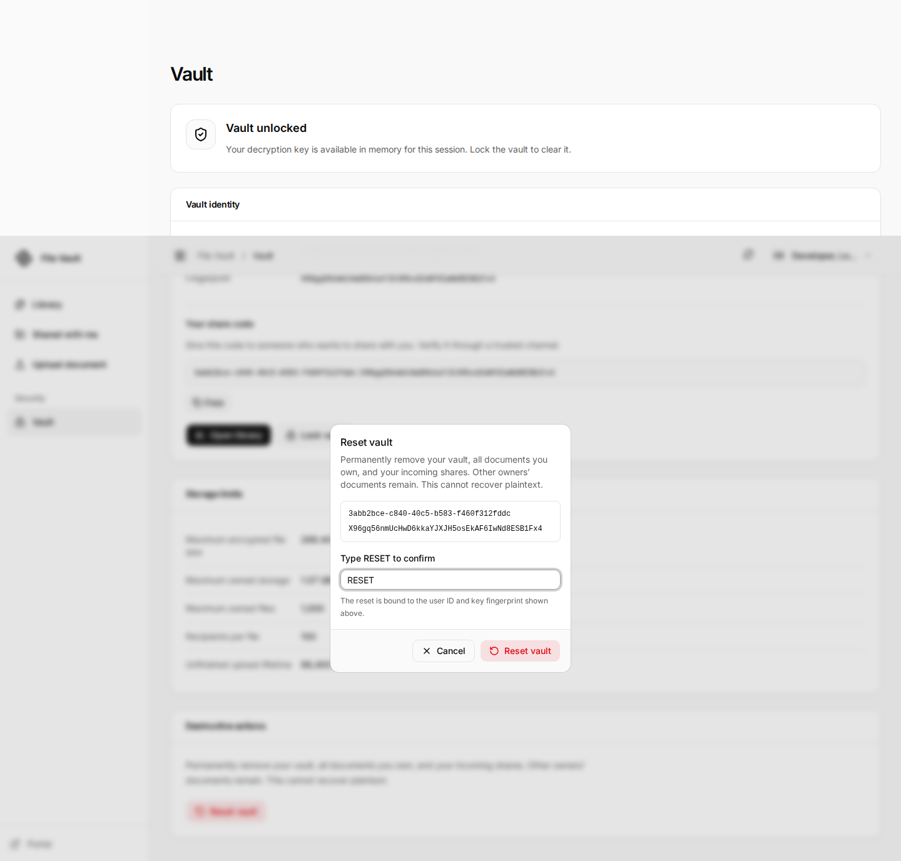](images/file-vault/reset-confirmation.png)

<figcaption>Review the target and permanent consequences before confirming.</figcaption>
</figure>

<figure className="doc-screenshot">

[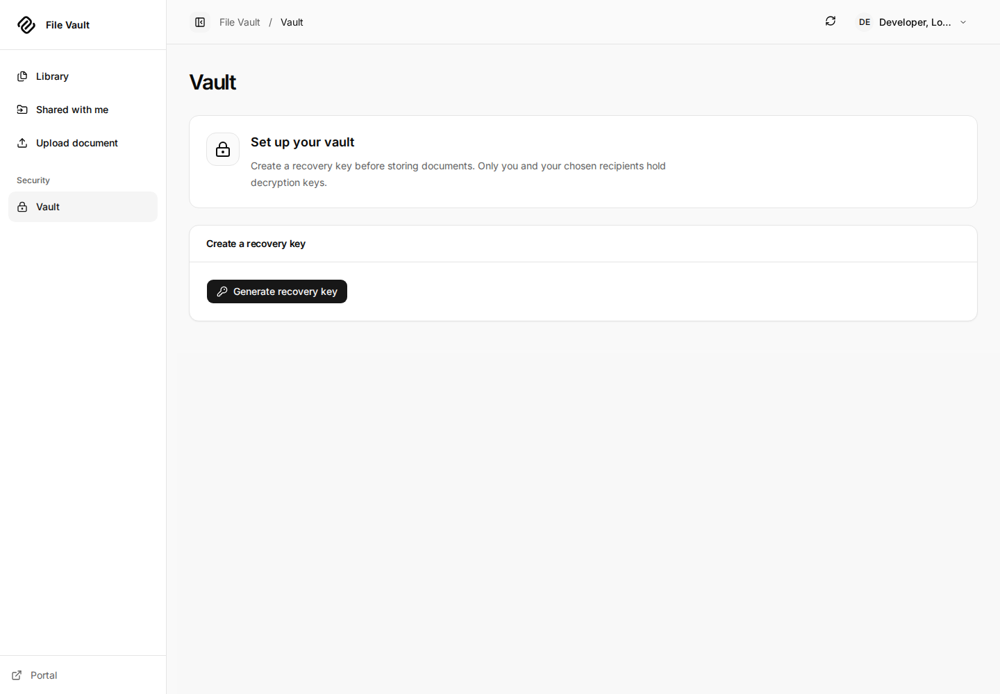](images/file-vault/reset-completed.png)

<figcaption>Reset completes by removing the old context, then offering a fresh enrollment.</figcaption>
</figure>

</details>

## Preferences, diagnostics and troubleshooting

Choose **Preferences** from the avatar menu to set language, timezone and
appearance for this device. Choose **Diagnostics** for UI version, app path,
browser settings, protocol, portal/user IDs, vault state, chunk size and file
limit. Share only the relevant nonsecret fields when asking for help.

<details className="screenshot-gallery">
<summary>Dark appearance, diagnostics and sign out</summary>

<figure className="doc-screenshot">

[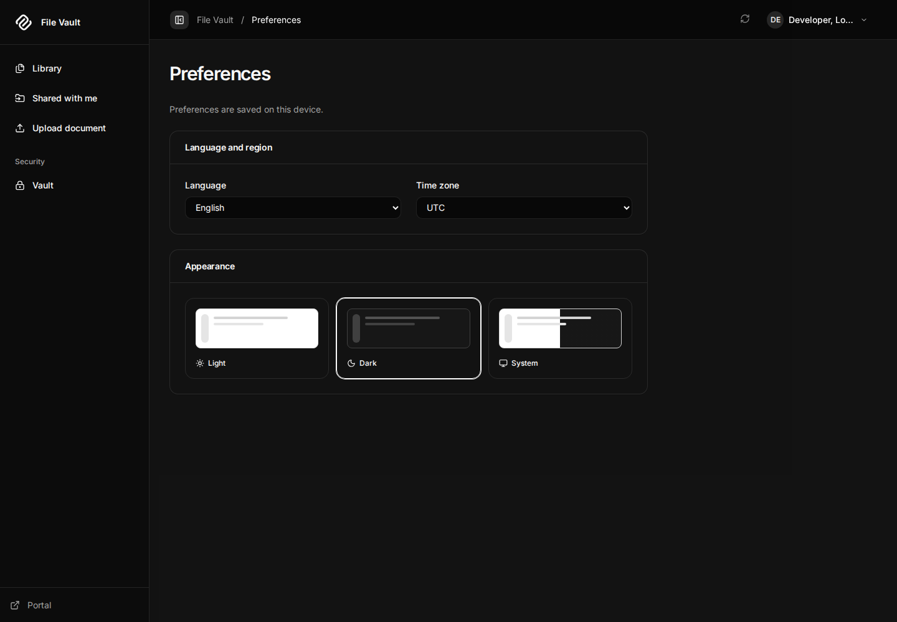](images/file-vault/preferences-dark.png)

<figcaption>Appearance changes the browser's presentation, independently of encryption and server policy.</figcaption>
</figure>

<figure className="doc-screenshot">

[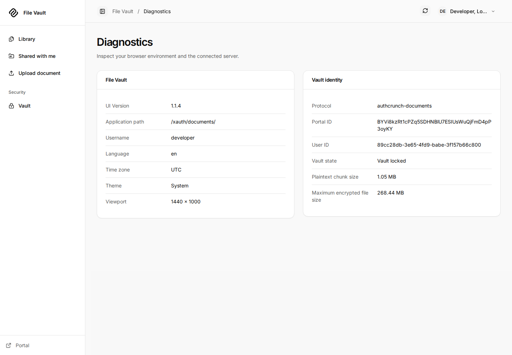](images/file-vault/diagnostics.png)

<figcaption>The UI version and configured portal context help identify which application and server are involved.</figcaption>
</figure>

<figure className="doc-screenshot">

[](images/file-vault/signed-out.png)

<figcaption>Sign out ends portal access; a later session also needs the recovery key to unlock the vault.</figcaption>
</figure>

</details>

| Symptom | What to check |
| --- | --- |
| No File Vault portal link or unavailable app | Enabled and initialized Documents API, correct role, and the version actually running |
| App opens but API access is forbidden | Current local browser login, allowed realm, exact public HTTPS origin and base path; a standalone JWT or external login is insufficient |
| Filename becomes an encrypted placeholder | Unlock again; locking/reloading drops local key access |
| Recovery import fails | Correct recovery file for this portal, account and current fingerprint; resetting/enrolling creates a different key context |
| Recipient verification fails | Exact share code, current enrolled recipient key and independently checked fingerprint |
| Upload fails or quota is exhausted | Current limits, pending reservations, original local file and whether a prior uncertain upload was allocated |
| Download fails integrity checks | Stop and investigate ciphertext, account/key context or transfer errors; no completed plaintext download should be offered |

Encryption protects stored/transmitted content from passive inspection. It does
not hide file sizes, timing, user IDs or sharing relationships, and does not
protect against a compromised browser, modified served JavaScript, or a recipient
who keeps a copy. See the [Documents API guide](../authenticate/api/documents.md)
for protocol, session authority, limits and operation paths.

## Agentic Prompts

Use a prompt to explore this workflow against your deployed release.

<div className="agentic-prompts">

<details>
<summary>Explain recovery and vault lifetimes</summary>

```text
Primary authorities, before website documentation:
https://github.com/greenpau/caddy-security/blob/main/AGENTS.md
https://github.com/greenpau/caddy-security/tree/main/.codex/skills
https://github.com/greenpau/go-authcrunch/blob/main/AGENTS.md
https://github.com/greenpau/go-authcrunch/tree/main/.codex/skills
Read each root AGENTS.md first, then any scoped AGENTS.md applying to inspected
paths, then the relevant SKILL.md files and their implementation/test references.
Distinguish main, caddy-security v1.6.2 / go-authcrunch v1.5.0, the UI asset
version, and my deployed release. Resolve differences with code/tests. Keep
unverified behavior uncertain. Ask for pasted sources if they are inaccessible.
Use synthetic or redacted inputs; never request tokens or recovery secrets.
Relevant skills to locate: authentication-portal-documents; documents-app-integration; documents-implementation.
Secondary context: https://docs.authcrunch.com/docs/apps/file-vault

Teach back enrollment, backup acknowledgement, encrypted registration, local unlock, reload, lock and fresh browser login. Compare recovery key, portal password, public fingerprint and share code. Explain precisely what reset deletes.
```

</details>

<details>
<summary>Trace an interrupted encrypted upload</summary>

```text
Primary authorities, before website documentation:
https://github.com/greenpau/caddy-security/blob/main/AGENTS.md
https://github.com/greenpau/caddy-security/tree/main/.codex/skills
https://github.com/greenpau/go-authcrunch/blob/main/AGENTS.md
https://github.com/greenpau/go-authcrunch/tree/main/.codex/skills
Read each root AGENTS.md first, then any scoped AGENTS.md applying to inspected
paths, then the relevant SKILL.md files and their implementation/test references.
Distinguish main, caddy-security v1.6.2 / go-authcrunch v1.5.0, the UI asset
version, and my deployed release. Resolve differences with code/tests. Keep
unverified behavior uncertain. Ask for pasted sources if they are inaccessible.
Use synthetic or redacted inputs; never request tokens or recovery secrets.
Relevant skills to locate: authentication-portal-documents; documents-app-integration; documents-implementation.
Secondary context: https://docs.authcrunch.com/docs/apps/file-vault

Trace allocation, encrypted metadata/chunks, commit and authenticated download for a two-chunk synthetic file. Analyze ambiguous allocation, exact-ciphertext retry, pending quota and expiry, reload and integrity failure.
```

</details>

<details>
<summary>Verify a recipient safely</summary>

```text
Primary authorities, before website documentation:
https://github.com/greenpau/caddy-security/blob/main/AGENTS.md
https://github.com/greenpau/caddy-security/tree/main/.codex/skills
https://github.com/greenpau/go-authcrunch/blob/main/AGENTS.md
https://github.com/greenpau/go-authcrunch/tree/main/.codex/skills
Read each root AGENTS.md first, then any scoped AGENTS.md applying to inspected
paths, then the relevant SKILL.md files and their implementation/test references.
Distinguish main, caddy-security v1.6.2 / go-authcrunch v1.5.0, the UI asset
version, and my deployed release. Resolve differences with code/tests. Keep
unverified behavior uncertain. Ask for pasted sources if they are inaccessible.
Use synthetic or redacted inputs; never request tokens or recovery secrets.
Relevant skills to locate: authentication-portal-documents; documents-app-integration; documents-implementation.
Secondary context: https://docs.authcrunch.com/docs/apps/file-vault

Walk through two users with independent vaults and a public User-ID:Fingerprint code. Explain independent identity verification, key lookup, wrapping and grant confirmation. Distinguish this UI format from lower-level protocol examples.
```

</details>

<details>
<summary>Reason about revocation and ownership</summary>

```text
Primary authorities, before website documentation:
https://github.com/greenpau/caddy-security/blob/main/AGENTS.md
https://github.com/greenpau/caddy-security/tree/main/.codex/skills
https://github.com/greenpau/go-authcrunch/blob/main/AGENTS.md
https://github.com/greenpau/go-authcrunch/tree/main/.codex/skills
Read each root AGENTS.md first, then any scoped AGENTS.md applying to inspected
paths, then the relevant SKILL.md files and their implementation/test references.
Distinguish main, caddy-security v1.6.2 / go-authcrunch v1.5.0, the UI asset
version, and my deployed release. Resolve differences with code/tests. Keep
unverified behavior uncertain. Ask for pasted sources if they are inaccessible.
Use synthetic or redacted inputs; never request tokens or recovery secrets.
Relevant skills to locate: authentication-portal-documents; documents-app-integration; documents-implementation.
Secondary context: https://docs.authcrunch.com/docs/apps/file-vault

Compare a recipient, an unrelated administrator and the owner. Explain allowed operations, incoming grants, revocation, deletion and already-downloaded plaintext. Analyze recipient reset and changed fingerprints.
```

</details>

<details>
<summary>Diagnose a locked or unavailable library</summary>

```text
Primary authorities, before website documentation:
https://github.com/greenpau/caddy-security/blob/main/AGENTS.md
https://github.com/greenpau/caddy-security/tree/main/.codex/skills
https://github.com/greenpau/go-authcrunch/blob/main/AGENTS.md
https://github.com/greenpau/go-authcrunch/tree/main/.codex/skills
Read each root AGENTS.md first, then any scoped AGENTS.md applying to inspected
paths, then the relevant SKILL.md files and their implementation/test references.
Distinguish main, caddy-security v1.6.2 / go-authcrunch v1.5.0, the UI asset
version, and my deployed release. Resolve differences with code/tests. Keep
unverified behavior uncertain. Ask for pasted sources if they are inaccessible.
Use synthetic or redacted inputs; never request tokens or recovery secrets.
Relevant skills to locate: authentication-portal-documents; documents-app-integration; documents-implementation.
Secondary context: https://docs.authcrunch.com/docs/apps/file-vault

Analyze missing feature links, failed bootstrap, forbidden origin/realm, locked filenames, current-page search and invalid recovery import. Explain which evidence calls for fresh login, unlocking or server configuration repair without suggesting a destructive reset as a generic fix.
```

</details>

</div>

## Source Code References

- [Search the upstream implementations](https://github.com/search?q=%28repo%3Agreenpau%2Fcaddy-security%20OR%20repo%3Agreenpau%2Fgo-authcrunch%29%20documents%20ResetKey%20DocumentsEnabled&type=code).
- [caddyfile_authn_documents.go (caddy-security v1.6.2)](https://github.com/greenpau/caddy-security/blob/v1.6.2/caddyfile_authn_documents.go): Enablement and storage configuration.
- [documents_http.go (go-authcrunch v1.5.0)](https://github.com/greenpau/go-authcrunch/blob/v1.5.0/pkg/authn/documents_http.go): Session authority and operation admission.
- [Documents store.go (v1.5.0)](https://github.com/greenpau/go-authcrunch/blob/v1.5.0/pkg/authn/documents/store.go): Ownership, storage and destructive reset.
- [Browser crypto helper (v1.5.0)](https://github.com/greenpau/go-authcrunch/blob/v1.5.0/pkg/authn/documents/client/crypto.mjs): Encryption, recovery and key envelopes.
- [Embedded applications browser tests (go-authcrunch v1.5.0)](https://github.com/greenpau/go-authcrunch/blob/v1.5.0/pkg/authn/ui/testdata/portal_apps_browser_e2e.cjs): Bundled app rendering and mount-aware browser checks.
