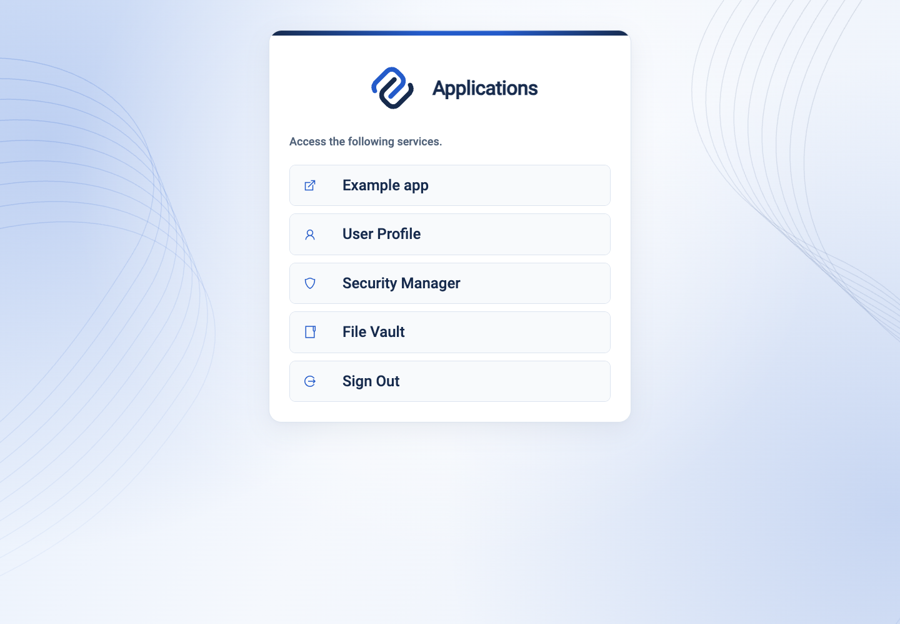

import CodeBlock from '@theme/CodeBlock';
import portalConfig from '@site/assets/conf/apps/portal/Caddyfile?raw';

# Built-in portal applications

**caddy-security v1.6.2**, using **go-authcrunch v1.5.0**, includes three browser
applications inside the executable. Open the authentication portal, sign in,
and choose an application. You do not need Node.js, a separate frontend server,
or a static-file deployment to use the bundled apps.

| Application | With a portal at `/auth` | Purpose | Access |
| --- | --- | --- | --- |
| [User Profile](user-profile.md) | `/auth/profile/` | Account information, credentials, authenticators, connected accounts and login rules | `authp/user` or `authp/admin`; profile operations keep their own API/session requirements |
| [Security Manager](security-manager.md) | `/auth/operator/` | Identity stores, users, roles, authentication rules, signing keys and service information | Enabled Admin API and `authp/admin` |
| [File Vault](file-vault.md) | `/auth/documents/` | Locally encrypted files, downloads, recipient sharing and recovery keys | Enabled and initialized Documents API and `authp/user` or `authp/admin`; file operations require a current local browser login |

The portal computes these links for the signed-in account. A user sees no
Security Manager link, and disabled features have no application link. Direct
requests still enforce the application's role and feature checks. The Profile
shell is available independently of its API; opening it does not establish
permission to change a local account.

<figure className="doc-screenshot">

[](images/portal-apps/portal.png)

<figcaption>The released v1.6.2 executable adds the three links automatically. Alice has both portal roles in the example below.</figcaption>
</figure>

## Run all three locally

Install the [caddy-security v1.6.2 executable](https://github.com/greenpau/caddy-security/releases/tag/v1.6.2)
or the [AuthCrunch v1.6.2 distribution](https://github.com/authcrunch/authcrunch/releases/tag/v1.6.2).
The latter includes the optional backend companions. These apps and the local
JSON/Documents features used here do not require an extra companion. Verify
the checksum from the repository that supplied your archive; the two repositories
use the same archive filenames.

Create an empty working directory, save the configuration below there as
`Caddyfile`, and prepare its private data directory:

```sh
mkdir -p data
chmod 700 data
export AUTHCRUNCH_APPS_DATA_DIR="$PWD/data"
authcrunch version
authcrunch security version
authcrunch adapt --config Caddyfile --adapter caddyfile > /dev/null
authcrunch run --config Caddyfile --adapter caddyfile
```

`security version` should report go-authcrunch v1.5.0 for the selected release.
The configuration uses HTTPS on localhost:8443 and a loopback certificate
approval endpoint on port 5555. Both ports must be free. Its local CA is not
installed in your system trust store; accept the local certificate exception
only for this exercise or use a browser that already trusts your local CA.

:::warning[Local demonstration configuration]

The passwords and signing key below are public demo values. Run this example
only on your own workstation with disposable accounts and files. Production
needs your hostname, trusted HTTPS, private signing material, appropriate roles,
and protected durable storage. The example enables account administration.

:::

<CodeBlock language="caddyfile" title="Caddyfile">{portalConfig}</CodeBlock>

Sign in at `https://localhost:8443/auth/portal` with one of these accounts:

| Account | Password | Expected applications |
| --- | --- | --- |
| `alice` | `LocalDemoPassword123!` | User Profile, Security Manager, File Vault |
| `bob` | `LocalDemoPassword123!` | User Profile, File Vault |

Alice is the administrator. Use Bob in a separate browser profile or private
window when testing sharing or denied administrative access. The local store
can also create its bootstrap administrator; use the named accounts above for
this walkthrough.

The account database is `data/users.json`; encrypted documents are in
`data/documents.db`; local certificate state is under `data/caddy`. Keep these
private and outside served directories. The Documents path must be absolute,
which is why the command supplies `AUTHCRUNCH_APPS_DATA_DIR`. Retain the same
account store and portal binding when restarting if you want to retain file
access. Stop the foreground process with Ctrl+C when finished.

## Follow the application walkthroughs

1. [User Profile](user-profile.md): inspect your account, manage credentials,
   enroll an authenticator, and review effective login rules.
2. [Security Manager](security-manager.md): inspect a realm, create a disposable
   user, edit roles/rules, and understand protected signing-key export.
3. [File Vault](file-vault.md): save a recovery key, enroll and unlock, upload
   and download, share with Bob, revoke access, and review reset consequences.

The sidebar switches app pages; the avatar menu contains **Preferences**,
**Diagnostics**, **Portal**, and **Sign out**. On phones the sidebar becomes a
drawer. Preferences change this browser's language, timezone and appearance;
they do not change server authentication policy. Diagnostics helps distinguish
the UI version from the server/library version.

## Deploy at a different portal mount

Keep the complete request path when delegating to `authenticate`. The portal
serves the application HTML, assets, fonts, translations, and deep links itself;
do not strip `/auth` or add a Vite proxy for these bundled applications.

| Portal mount | Profile | Security Manager | File Vault |
| --- | --- | --- | --- |
| `/` | `/profile/` | `/operator/` | `/documents/` |
| `/auth` | `/auth/profile/` | `/auth/operator/` | `/auth/documents/` |
| `/company/auth` | `/company/auth/profile/` | `/company/auth/operator/` | `/company/auth/documents/` |

For a nested mount, change the route matcher, bare-mount redirect,
`authenticate ... at` argument, authorization login URL, and Documents base path
together. For a root mount, use `/` as the explicit mount and Documents base path.
The Documents public origin remains only the HTTPS scheme, hostname and optional
port. Its database binds the portal name, public origin and base path: moving an
existing encrypted database is a separate migration problem, not a link edit.

The portal injects each app's canonical HTML base. Reloading a deep link uses
that same base for lazy-loaded code and translations. Missing files under
`assets/` or `i18n/` return 404 instead of application HTML. Portal CSS/template
overrides do not rebuild or restyle the embedded React apps.

## Check access and diagnose failures

| Check or symptom | Expected result or next step |
| --- | --- |
| Alice opens all three links | App content loads; File Vault initially asks for vault enrollment |
| Bob opens `/auth/operator/` directly | Access is denied even though he is signed in |
| Documents or Admin API disabled | The corresponding app is unavailable and its portal link is omitted |
| Profile opens but account actions fail | Check local-account authority, Profile API availability, and fresh browser login; shell access alone is insufficient |
| Documents reports a permission error | Check the local login, admitted realm, exact HTTPS origin and portal mount; an administrator cannot bypass document ownership |
| Deep link loads HTML as JavaScript or loses assets | Verify full path delegation and the selected release; remove unrelated static/proxy catchalls |
| Session expires | Follow the app back to portal authentication; unlock File Vault again after fresh login |

The example was adapted and run with the checksum-verified caddy-security
v1.6.2 macOS arm64 archive. Browser checks covered both roles, the three app
entries, Documents bootstrap, deep-link pages, and missing-asset rejection.
See [feature versions](../operations/versions.md) for earlier baselines.

## Agentic Prompts

Use a prompt to explore this workflow against your deployed release.

<div className="agentic-prompts">

<details>
<summary>Explain who sees each app</summary>

```text
Primary authorities, before website documentation:
https://github.com/greenpau/caddy-security/blob/main/AGENTS.md
https://github.com/greenpau/caddy-security/tree/main/.codex/skills
https://github.com/greenpau/go-authcrunch/blob/main/AGENTS.md
https://github.com/greenpau/go-authcrunch/tree/main/.codex/skills
Read each root AGENTS.md first, then any scoped AGENTS.md applying to inspected
paths, then the relevant SKILL.md files and their implementation/test references.
Distinguish main, caddy-security v1.6.2 / go-authcrunch v1.5.0, the UI asset
version, and my deployed release. Resolve differences with code/tests. Keep
unverified behavior uncertain. Ask for pasted sources if they are inaccessible.
Use synthetic or redacted inputs; never request tokens or recovery secrets.
Relevant skills to locate: configuration-authentication-ui; configuration-http-integrations; application-implementation.
Secondary context: https://docs.authcrunch.com/docs/apps/portal-apps

Trace portal menu construction, app enablement and server role checks for a user and an administrator. Explain why a hidden link is not the access-control boundary and why Profile shell access differs from API authority.
```

</details>

<details>
<summary>Deploy under a nested mount</summary>

```text
Primary authorities, before website documentation:
https://github.com/greenpau/caddy-security/blob/main/AGENTS.md
https://github.com/greenpau/caddy-security/tree/main/.codex/skills
https://github.com/greenpau/go-authcrunch/blob/main/AGENTS.md
https://github.com/greenpau/go-authcrunch/tree/main/.codex/skills
Read each root AGENTS.md first, then any scoped AGENTS.md applying to inspected
paths, then the relevant SKILL.md files and their implementation/test references.
Distinguish main, caddy-security v1.6.2 / go-authcrunch v1.5.0, the UI asset
version, and my deployed release. Resolve differences with code/tests. Keep
unverified behavior uncertain. Ask for pasted sources if they are inaccessible.
Use synthetic or redacted inputs; never request tokens or recovery secrets.
Relevant skills to locate: configuration-authentication-ui; configuration-http-integrations; application-implementation.
Secondary context: https://docs.authcrunch.com/docs/apps/portal-apps

Walk through moving a fresh synthetic portal from /auth to /company/auth. Identify every route, redirect, login URL, Documents binding and asset base that must agree. Separate a new deployment from migration of an existing Documents database.
```

</details>

<details>
<summary>Diagnose a broken deep link</summary>

```text
Primary authorities, before website documentation:
https://github.com/greenpau/caddy-security/blob/main/AGENTS.md
https://github.com/greenpau/caddy-security/tree/main/.codex/skills
https://github.com/greenpau/go-authcrunch/blob/main/AGENTS.md
https://github.com/greenpau/go-authcrunch/tree/main/.codex/skills
Read each root AGENTS.md first, then any scoped AGENTS.md applying to inspected
paths, then the relevant SKILL.md files and their implementation/test references.
Distinguish main, caddy-security v1.6.2 / go-authcrunch v1.5.0, the UI asset
version, and my deployed release. Resolve differences with code/tests. Keep
unverified behavior uncertain. Ask for pasted sources if they are inaccessible.
Use synthetic or redacted inputs; never request tokens or recovery secrets.
Relevant skills to locate: configuration-authentication-ui; configuration-http-integrations; application-implementation.
Secondary context: https://docs.authcrunch.com/docs/apps/portal-apps

Analyze a deep-link reload that returns HTML as JavaScript. Compare canonical base injection, missing-asset 404 handling, path preservation and an unrelated proxy catchall. Propose focused observations before a configuration change.
```

</details>

<details>
<summary>Compare embedded and development hosting</summary>

```text
Primary authorities, before website documentation:
https://github.com/greenpau/caddy-security/blob/main/AGENTS.md
https://github.com/greenpau/caddy-security/tree/main/.codex/skills
https://github.com/greenpau/go-authcrunch/blob/main/AGENTS.md
https://github.com/greenpau/go-authcrunch/tree/main/.codex/skills
Read each root AGENTS.md first, then any scoped AGENTS.md applying to inspected
paths, then the relevant SKILL.md files and their implementation/test references.
Distinguish main, caddy-security v1.6.2 / go-authcrunch v1.5.0, the UI asset
version, and my deployed release. Resolve differences with code/tests. Keep
unverified behavior uncertain. Ask for pasted sources if they are inaccessible.
Use synthetic or redacted inputs; never request tokens or recovery secrets.
Relevant skills to locate: configuration-authentication-ui; configuration-http-integrations; application-implementation.
Secondary context: https://docs.authcrunch.com/docs/apps/portal-apps

Explain which process serves the production embedded apps and which processes serve the separately developed React source. Compare integration, library and UI versions without prescribing a Vite deployment for a bundled app.
```

</details>

<details>
<summary>Design the access walkthrough</summary>

```text
Primary authorities, before website documentation:
https://github.com/greenpau/caddy-security/blob/main/AGENTS.md
https://github.com/greenpau/caddy-security/tree/main/.codex/skills
https://github.com/greenpau/go-authcrunch/blob/main/AGENTS.md
https://github.com/greenpau/go-authcrunch/tree/main/.codex/skills
Read each root AGENTS.md first, then any scoped AGENTS.md applying to inspected
paths, then the relevant SKILL.md files and their implementation/test references.
Distinguish main, caddy-security v1.6.2 / go-authcrunch v1.5.0, the UI asset
version, and my deployed release. Resolve differences with code/tests. Keep
unverified behavior uncertain. Ask for pasted sources if they are inaccessible.
Use synthetic or redacted inputs; never request tokens or recovery secrets.
Relevant skills to locate: configuration-authentication-ui; configuration-http-integrations; application-implementation.
Secondary context: https://docs.authcrunch.com/docs/apps/portal-apps

Design a disposable two-account check for all three app entries, forbidden administrative requests, disabled features, fresh local login and File Vault unlock. State which checks establish configuration versus actual runtime behavior.
```

</details>

</div>

## Source Code References

- [Search the upstream implementations](https://github.com/search?q=%28repo%3Agreenpau%2Fcaddy-security%20OR%20repo%3Agreenpau%2Fgo-authcrunch%29%20portalAppEnabled%20handleHTTPApps&type=code).
- [caddy-security configuration-authentication-ui (v1.6.2)](https://github.com/greenpau/caddy-security/blob/v1.6.2/.codex/skills/configuration-authentication-ui/SKILL.md): Embedded app configuration boundaries.
- [portal_apps.go (go-authcrunch v1.5.0)](https://github.com/greenpau/go-authcrunch/blob/v1.5.0/pkg/authn/portal_apps.go): Application names, namespaces and feature gates.
- [handle_http_apps.go (v1.5.0)](https://github.com/greenpau/go-authcrunch/blob/v1.5.0/pkg/authn/handle_http_apps.go): Role checks, base injection, assets and SPA fallback.
- [handle_http_portal.go (v1.5.0)](https://github.com/greenpau/go-authcrunch/blob/v1.5.0/pkg/authn/handle_http_portal.go): Per-user application links.
- [portal_apps_e2e_test.go (v1.5.0)](https://github.com/greenpau/go-authcrunch/blob/v1.5.0/pkg/authn/portal_apps_e2e_test.go): Root/nested mounts and app access tests.
