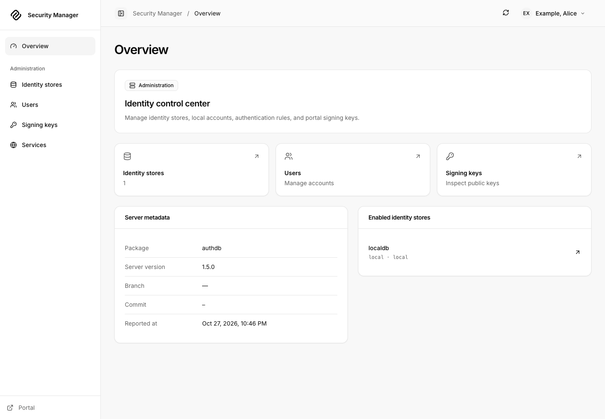
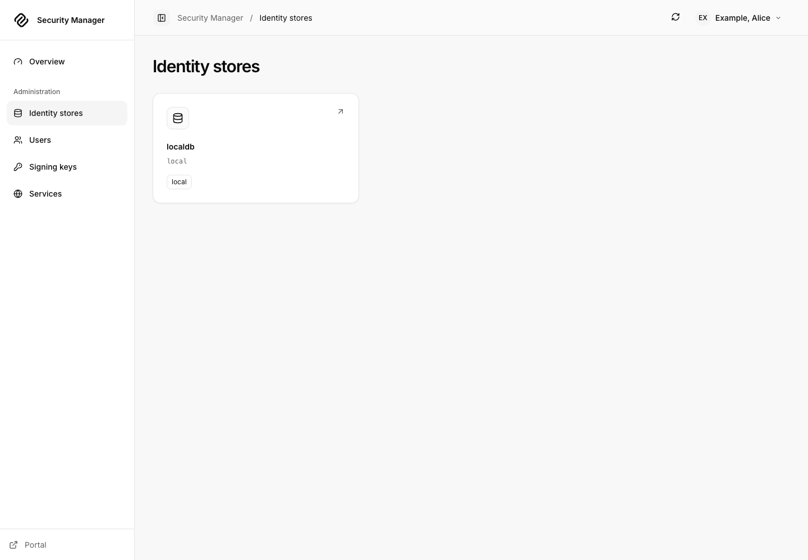
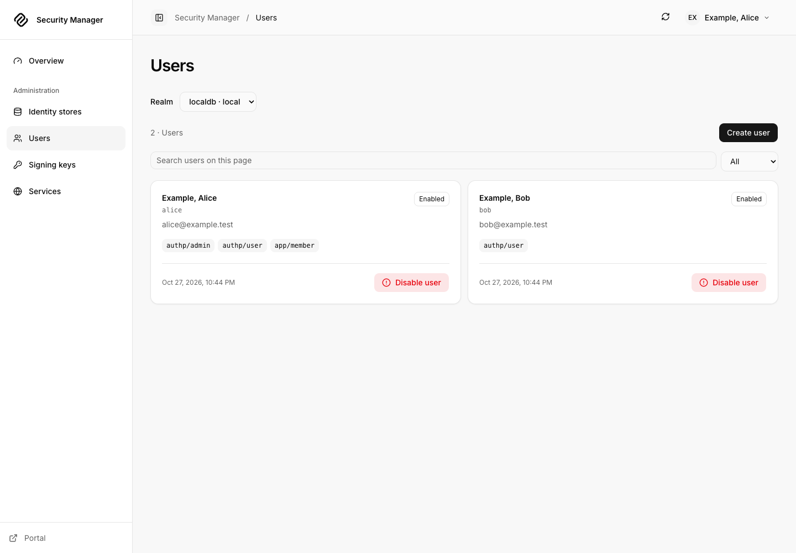
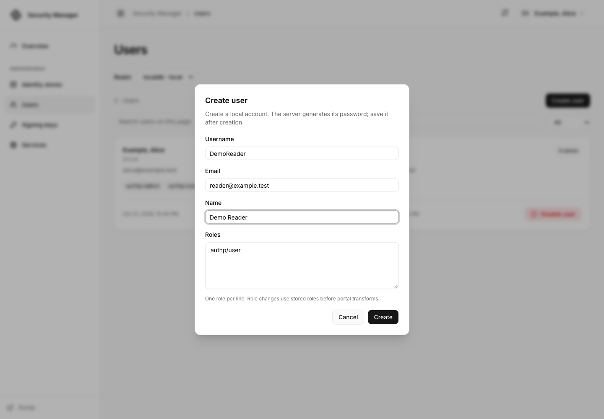
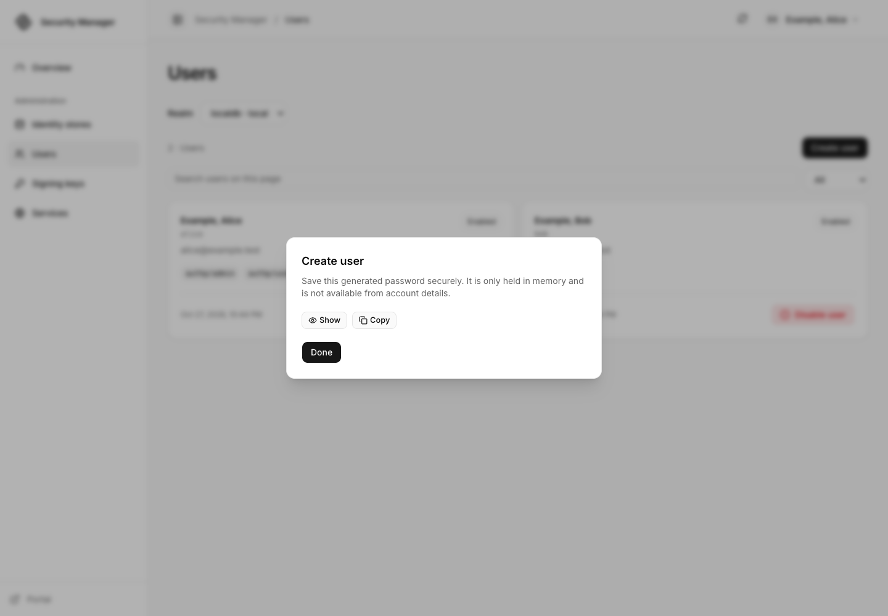
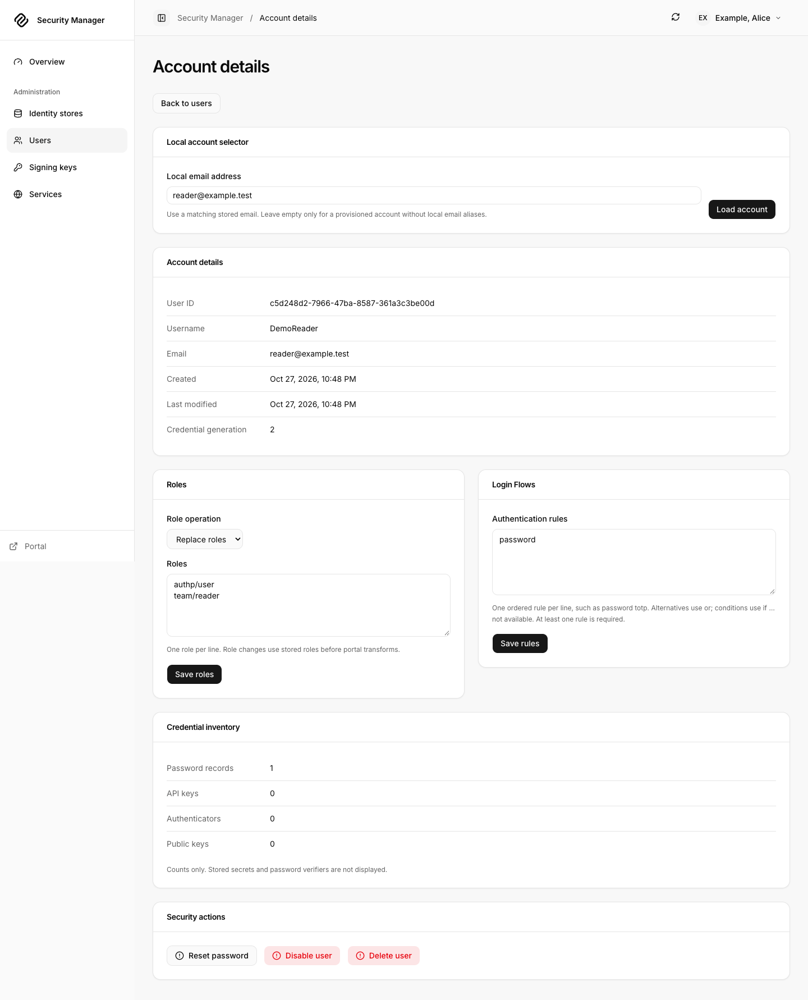
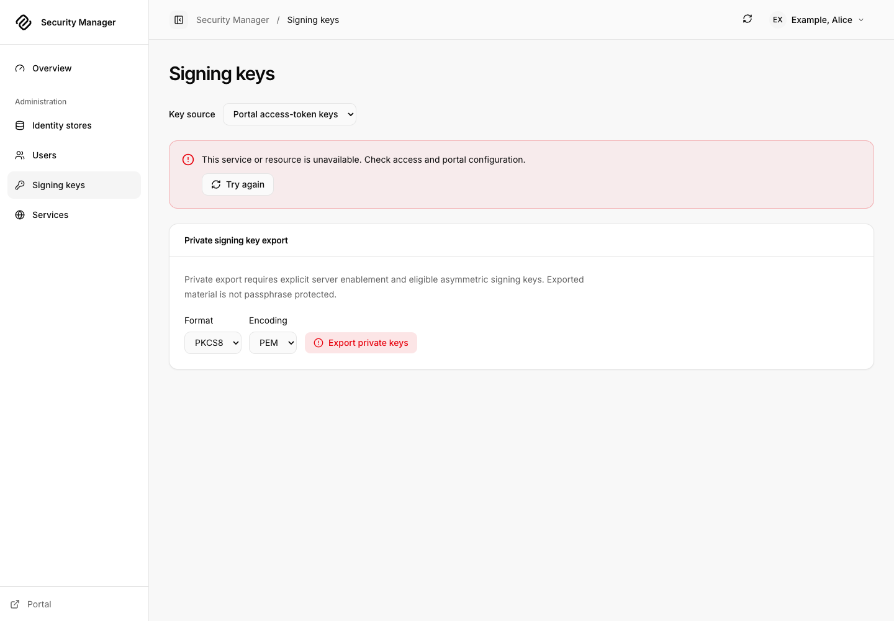
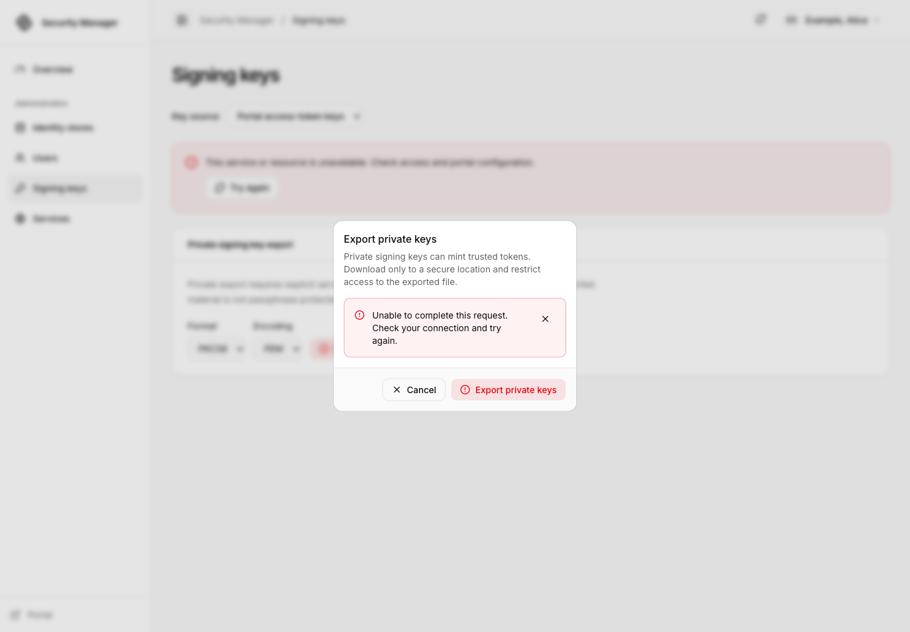
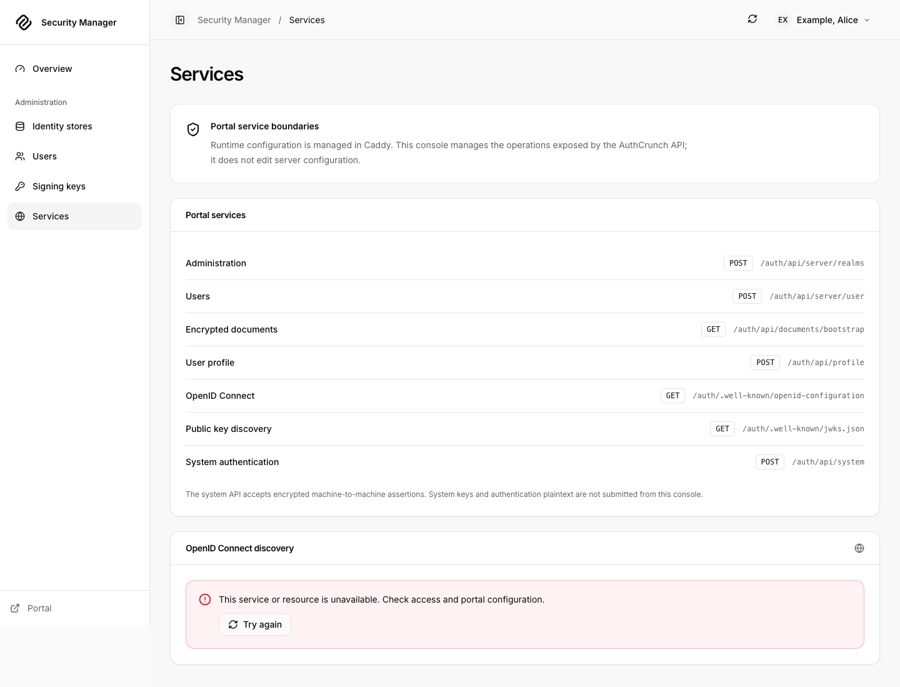

# Security Manager walkthrough

Security Manager is the administrator app at `/auth/operator/` for a portal
mounted at `/auth`. It ships in **caddy-security v1.6.2 / go-authcrunch v1.5.0**.
It requires both **`enable admin api`** in that portal and the exact reserved
role **`authp/admin`**. A role named `admin` does not qualify.

Use the [local application setup](portal-apps.md), sign in as Alice, and choose
**Security Manager**. Bob should have no link and should be denied when opening
the URL directly. In production, grant administration only through your trusted
provisioning process. Menu visibility does not replace server authorization.

## 1. Inspect the overview and identity stores

The overview summarizes server metadata and configured identity services.
Open **Identity stores**, choose a realm, and inspect its backend, policy and
persistence information. These pages describe the runtime actually answering
the Admin API, which is useful when multiple portals or stores are configured.

<figure className="doc-screenshot">

[](images/portal-apps/operator-overview.png)

<figcaption>The overview establishes which server and identity stores you are administering.</figcaption>
</figure>

**Reload realm** requests a reload of the selected identity store after
confirmation. It is a store operation, not a Caddy configuration reload. For
backend configuration changes, edit the owning server configuration and use
the supported deployment procedure. Check the returned result before assuming
all stores were refreshed.

<details className="screenshot-gallery">
<summary>Identity-store inventory</summary>

<figure className="doc-screenshot">

[](images/portal-apps/operator-realms.png)

<figcaption>Open a realm to inspect its policy and available administrative operations.</figcaption>
</figure>

</details>

## 2. Create a disposable user

1. Open **Users** and select the intended realm.
2. Choose **Create user**. Enter a synthetic username such as `DemoReader`,
   email `reader@example.test`, and name `Demo Reader`.
3. Submit **Create** and wait for the success result. Handle the generated
   password privately using the result's explicit controls; do not place it
   in a ticket or screenshot.
4. Choose **Done**, find the new user, and open the account detail page.

<figure className="doc-screenshot">

[](images/portal-apps/operator-users.png)

<figcaption>Confirm the selected realm before creating or changing an account.</figcaption>
</figure>

Read-only or unsupported backends may expose inspection without the same
mutation controls. Follow the explanation supplied for that store. The app
does not turn an upstream provider into a writable local user database.

<details className="screenshot-gallery">
<summary>Create the disposable account and review the protected result</summary>

<figure className="doc-screenshot">

[](images/portal-apps/operator-create-user.png)

<figcaption>Choose the intended realm before supplying account details.</figcaption>
</figure>

<figure className="doc-screenshot">

[](images/portal-apps/operator-user-created.png)

<figcaption>Handle the generated password privately before closing the result.</figcaption>
</figure>

</details>

## 3. Edit roles and authentication rules

On the disposable account, review the roles editor's **replace** or **add** mode.
Replacing submits the intended complete set; adding preserves existing roles.
For a basic reader, use one role per line:

```text
authp/user
team/reader
```

Choose **Save roles** and verify the account's returned roles. Give ordinary
users only the required roles; `authp/admin` grants access to management APIs.
Role changes can invalidate existing login evidence, so test with a fresh login.

The **Authentication rules** editor uses the server's challenge-rule grammar.
For the local exercise, `password` is a simple rule to inspect and save on a
disposable account. Review the realm/portal policy and available factors before
requiring MFA. Use **Save rules**, then verify the stored result. See
[authentication challenges](../authenticate/13-authentication-challenges.md) for rule
ordering and factor behavior.

<figure className="doc-screenshot">

[](images/portal-apps/operator-account-rules.png)

<figcaption>The practice account's saved roles and rule can be reviewed before testing a fresh login.</figcaption>
</figure>

## 4. Reset, disable and remove the practice account

**Reset password** asks the server for a replacement credential. Review the
confirmation, retrieve the generated result privately, and use **Clear password**
when finished handling it. Do not assume the account's old password still works.

Use **Disable user** to block the account, verify its returned state, then
**Enable user** if you are practicing the reversible flow. **Delete user**
requires a separate confirmation and removes the account. Delete only your
disposable practice user. Recreating a username produces a new identity; it
does not restore that account's File Vault ownership.

After a timeout or uncertain mutation response, refresh and inspect the account
before deciding whether another submission is needed. A retry is not proof
that the original operation failed. Detailed operations and response contracts
are documented in the [Server API](../authenticate/api/40-server-api.md).

## 5. Review signing keys and services

**Signing keys** offers public key sources for the portal and OpenID Connect.
The local example uses a symmetric signing key, so its public-key source has
no asymmetric JWK to display. Its OIDC issuer is also unconfigured, and Services
shows that discovery failure. These are expected states in this local example.
An unavailable OIDC source can reflect an unconfigured issuer; it is separate
from the portal's public key set. Inspect the selected source before using it
to diagnose token verification.

<figure className="doc-screenshot">

[](images/portal-apps/operator-signing-keys.png)

<figcaption>The symmetric-key local example has no public JWK to display. Private-key export remains separately controlled.</figcaption>
</figure>

**Export private keys** is a sensitive, confirmed operation. Even an
administrator receives a denial unless the server independently enables
`enable admin api private key export`. The local setup intentionally leaves
that opt-in absent. The presence of the button does not mean export is enabled;
see [private export](../authenticate/api/40-server-api.md#private-signing-key-export)
for the server boundary and supported formats.

<details className="screenshot-gallery">
<summary>Export denied without the separate server opt-in</summary>

<figure className="doc-screenshot">

[](images/portal-apps/operator-export-denied.png)

<figcaption>An authenticated administrator still needs the independent export setting.</figcaption>
</figure>

</details>

**Services** presents available integration and discovery information. Runtime
configuration remains managed in Caddy; this page is not a configuration editor.
Use **Diagnostics** in the avatar menu for the app/browser and composed server
information, and **Portal** to switch applications.

<details className="screenshot-gallery">
<summary>Service information in the released app</summary>

<figure className="doc-screenshot">

[](images/portal-apps/operator-services.png)

<figcaption>Use service metadata to inspect configured capabilities; make configuration changes in their owning server configuration.</figcaption>
</figure>

</details>

Screenshots were captured from the checksum-verified caddy-security v1.6.2
executable with synthetic local accounts. The setup's role test separately
checks that Bob cannot open Security Manager or its protected assets.

## Agentic Prompts

Use a prompt to explore this workflow against your deployed release.

<div className="agentic-prompts">

<details>
<summary>Separate management access switches</summary>

```text
Primary authorities, before website documentation:
https://github.com/greenpau/caddy-security/blob/main/AGENTS.md
https://github.com/greenpau/caddy-security/tree/main/.codex/skills
https://github.com/greenpau/go-authcrunch/blob/main/AGENTS.md
https://github.com/greenpau/go-authcrunch/tree/main/.codex/skills
Read each root AGENTS.md first, then any scoped AGENTS.md applying to inspected
paths, then the relevant SKILL.md files and their implementation/test references.
Distinguish main, caddy-security v1.6.2 / go-authcrunch v1.5.0, the UI asset
version, and my deployed release. Resolve differences with code/tests. Keep
unverified behavior uncertain. Ask for pasted sources if they are inaccessible.
Use synthetic or redacted inputs; never request tokens or recovery secrets.
Relevant skills to locate: authentication-portal-api; configuration-authentication; operator-implementation.
Secondary context: https://docs.authcrunch.com/docs/apps/security-manager

Trace Admin API enablement, the exact authp/admin role, app shell/asset authorization and independent private-key-export opt-in. Explain the result for an ordinary portal user who types an operator URL directly.
```

</details>

<details>
<summary>Practice a disposable account lifecycle</summary>

```text
Primary authorities, before website documentation:
https://github.com/greenpau/caddy-security/blob/main/AGENTS.md
https://github.com/greenpau/caddy-security/tree/main/.codex/skills
https://github.com/greenpau/go-authcrunch/blob/main/AGENTS.md
https://github.com/greenpau/go-authcrunch/tree/main/.codex/skills
Read each root AGENTS.md first, then any scoped AGENTS.md applying to inspected
paths, then the relevant SKILL.md files and their implementation/test references.
Distinguish main, caddy-security v1.6.2 / go-authcrunch v1.5.0, the UI asset
version, and my deployed release. Resolve differences with code/tests. Keep
unverified behavior uncertain. Ask for pasted sources if they are inaccessible.
Use synthetic or redacted inputs; never request tokens or recovery secrets.
Relevant skills to locate: authentication-portal-api; configuration-authentication; operator-implementation.
Secondary context: https://docs.authcrunch.com/docs/apps/security-manager

Walk through creating DemoReader, handling the generated password privately, adding/replacing roles, saving a password rule, disabling/enabling and deleting. Explain how to verify each result after an uncertain response.
```

</details>

<details>
<summary>Explain realm reload</summary>

```text
Primary authorities, before website documentation:
https://github.com/greenpau/caddy-security/blob/main/AGENTS.md
https://github.com/greenpau/caddy-security/tree/main/.codex/skills
https://github.com/greenpau/go-authcrunch/blob/main/AGENTS.md
https://github.com/greenpau/go-authcrunch/tree/main/.codex/skills
Read each root AGENTS.md first, then any scoped AGENTS.md applying to inspected
paths, then the relevant SKILL.md files and their implementation/test references.
Distinguish main, caddy-security v1.6.2 / go-authcrunch v1.5.0, the UI asset
version, and my deployed release. Resolve differences with code/tests. Keep
unverified behavior uncertain. Ask for pasted sources if they are inaccessible.
Use synthetic or redacted inputs; never request tokens or recovery secrets.
Relevant skills to locate: authentication-portal-api; configuration-authentication; operator-implementation.
Secondary context: https://docs.authcrunch.com/docs/apps/security-manager

Compare Reload realm, refreshing the Users page, restarting Caddy and changing runtime configuration. Trace which data owner each action affects and identify backend-specific read-only or unsupported operations.
```

</details>

<details>
<summary>Diagnose unavailable signing keys</summary>

```text
Primary authorities, before website documentation:
https://github.com/greenpau/caddy-security/blob/main/AGENTS.md
https://github.com/greenpau/caddy-security/tree/main/.codex/skills
https://github.com/greenpau/go-authcrunch/blob/main/AGENTS.md
https://github.com/greenpau/go-authcrunch/tree/main/.codex/skills
Read each root AGENTS.md first, then any scoped AGENTS.md applying to inspected
paths, then the relevant SKILL.md files and their implementation/test references.
Distinguish main, caddy-security v1.6.2 / go-authcrunch v1.5.0, the UI asset
version, and my deployed release. Resolve differences with code/tests. Keep
unverified behavior uncertain. Ask for pasted sources if they are inaccessible.
Use synthetic or redacted inputs; never request tokens or recovery secrets.
Relevant skills to locate: authentication-portal-api; configuration-authentication; operator-implementation.
Secondary context: https://docs.authcrunch.com/docs/apps/security-manager

Analyze a local HMAC-signed portal with no asymmetric public JWK and no OIDC issuer. Explain public-source failures and separately denied private export without claiming the app automatically enables or rotates signing keys.
```

</details>

<details>
<summary>Review identity consequences</summary>

```text
Primary authorities, before website documentation:
https://github.com/greenpau/caddy-security/blob/main/AGENTS.md
https://github.com/greenpau/caddy-security/tree/main/.codex/skills
https://github.com/greenpau/go-authcrunch/blob/main/AGENTS.md
https://github.com/greenpau/go-authcrunch/tree/main/.codex/skills
Read each root AGENTS.md first, then any scoped AGENTS.md applying to inspected
paths, then the relevant SKILL.md files and their implementation/test references.
Distinguish main, caddy-security v1.6.2 / go-authcrunch v1.5.0, the UI asset
version, and my deployed release. Resolve differences with code/tests. Keep
unverified behavior uncertain. Ask for pasted sources if they are inaccessible.
Use synthetic or redacted inputs; never request tokens or recovery secrets.
Relevant skills to locate: authentication-portal-api; configuration-authentication; operator-implementation.
Secondary context: https://docs.authcrunch.com/docs/apps/security-manager

Explain how administrative password, role, rule, disable and delete operations affect current login evidence. Analyze deleting and recreating the same username and why it cannot inherit the previous File Vault owner UUID.
```

</details>

</div>

## Source Code References

- [Search the upstream implementations](https://github.com/search?q=%28repo%3Agreenpau%2Fcaddy-security%20OR%20repo%3Agreenpau%2Fgo-authcrunch%29%20AdminEnabled%20private_keys%20handleAPIAdmin&type=code).
- [caddyfile_authn_admin_api.go (caddy-security v1.6.2)](https://github.com/greenpau/caddy-security/blob/v1.6.2/caddyfile_authn_admin_api.go): Independent Admin API and private export switches.
- [handle_api_private_keys.go (go-authcrunch v1.5.0)](https://github.com/greenpau/go-authcrunch/blob/v1.5.0/pkg/authn/handle_api_private_keys.go): Private signing-key export enforcement.
- [Embedded applications browser tests (go-authcrunch v1.5.0)](https://github.com/greenpau/go-authcrunch/blob/v1.5.0/pkg/authn/ui/testdata/portal_apps_browser_e2e.cjs): Bundled app rendering and mount-aware browser checks.
