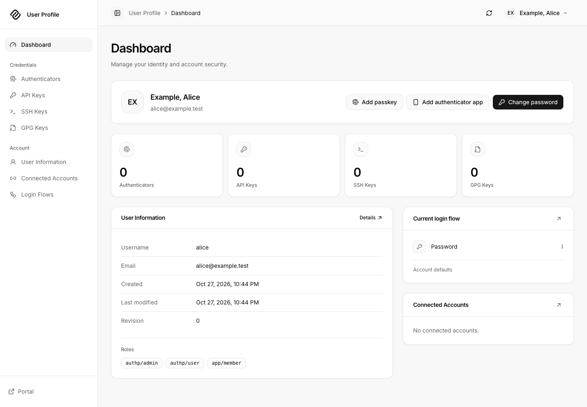
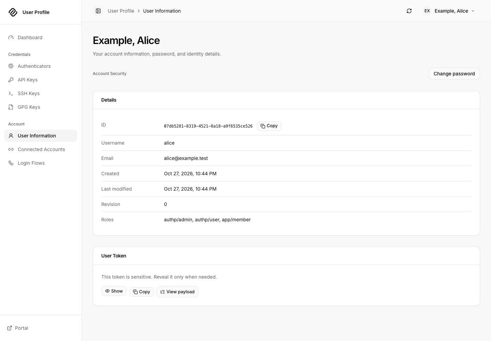
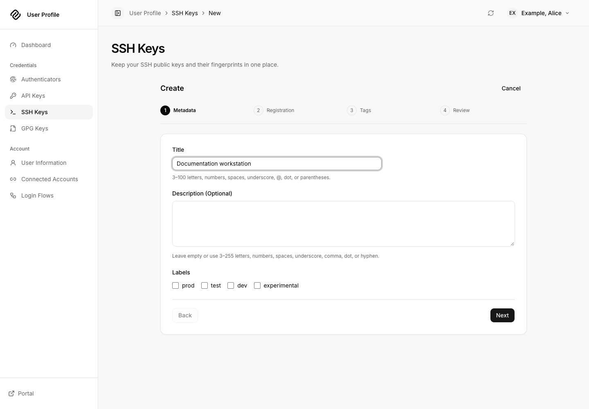
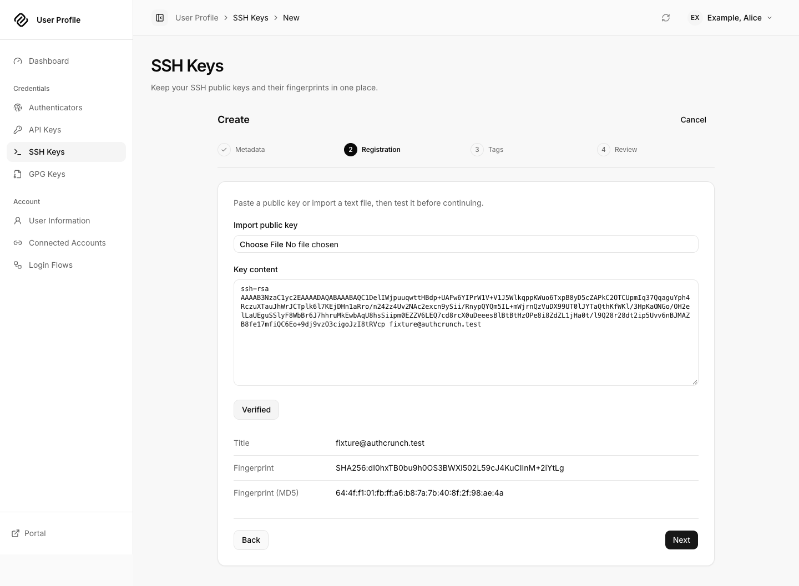
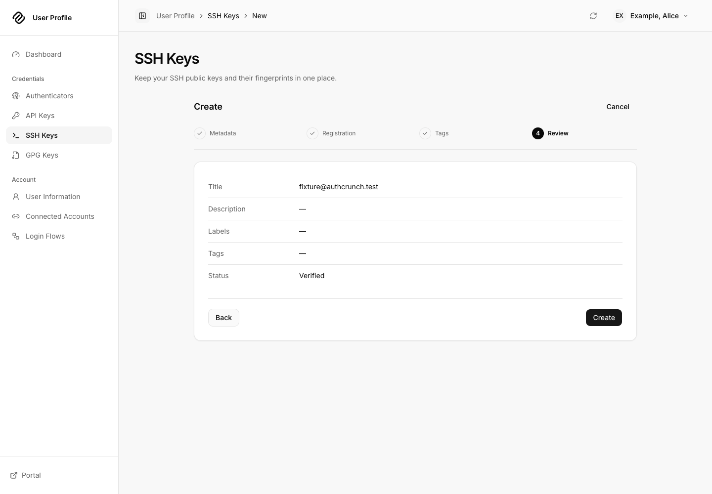
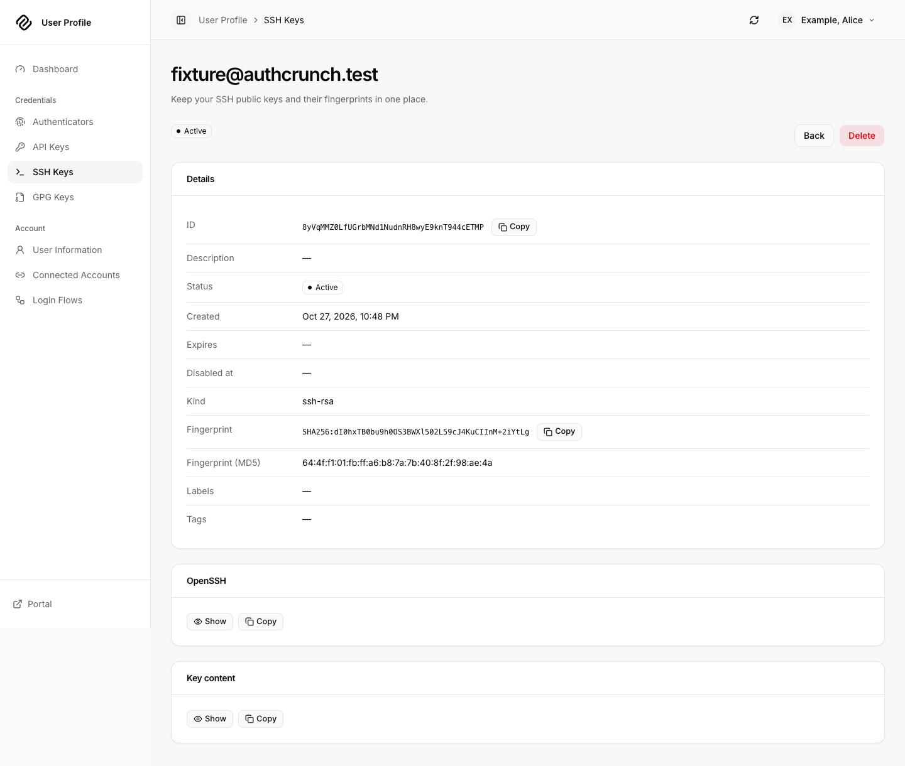
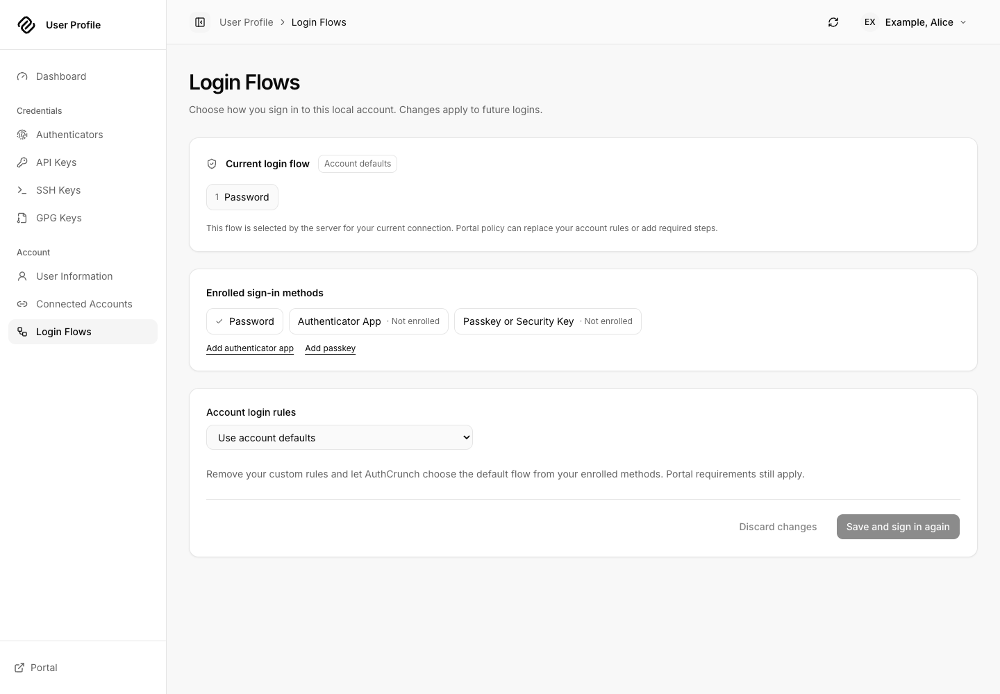

# User Profile walkthrough

User Profile is the self-service app at `/auth/profile/` when your portal is
mounted at `/auth`. It ships with **caddy-security v1.6.2 / go-authcrunch v1.5.0**.
Start with the [local application setup](portal-apps.md), sign in as Alice or
Bob, and choose **User Profile** on the portal's Applications page.

A portal user or administrator may open the app. Managing credentials requires
an eligible local account, an enabled Profile API, and a current browser login
session. Signing in through an external provider or holding an access token
does not by itself establish local self-service authority. Account mutations
can require fresh authentication before further operations.

## 1. Review the dashboard and account

The dashboard shows the verified signed-in identity, credential shortcuts,
and a summary of login rules. Choose **User Information** to inspect the
account and current token information. **Change password** is available from
the dashboard and account page for supported local accounts.

<figure className="doc-screenshot">

[](images/portal-apps/profile-dashboard.png)

<figcaption>The dashboard connects the current account to its credential collections and login settings.</figcaption>
</figure>

To change a password, enter the current password, new password and matching
confirmation. Submit **Change password**, wait for server confirmation, and
follow any fresh-login prompt. The new password must satisfy the server's
policy. Cancel closes the dialog without submitting the change.

The token's **View payload** action explains claims such as authentication
methods. Token material is sensitive: do not paste it into support tickets,
screenshots or public token inspection websites. A decoded claim tree is not
an independent check of token validity.

<details className="screenshot-gallery">
<summary>Account information in the released app</summary>

<figure className="doc-screenshot">

[](images/portal-apps/profile-account.png)

<figcaption>Inspect account fields and token information without exposing a raw credential.</figcaption>
</figure>

</details>

## 2. Add and inspect credentials

Open the appropriate collection from the sidebar or dashboard. Lists support
search, sorting, display options and selection where applicable. Open a saved
item to inspect its details; use the confirmation dialog when deleting it.
Deleting a credential changes server state and can affect applications using it.

| Collection | Creation flow | Expected outcome |
| --- | --- | --- |
| API Keys | **Create**, enter a title and key content, proceed through the steps, review and create | A named credential appears in API Keys; treat its secret as a password |
| SSH Keys | **Create**, enter a title, paste the public key and choose **Test**, then review and create | The app parses the public key before submission; keep the private key on your device |
| GPG Keys | **Create**, enter a title, paste the public OpenPGP key and choose **Test**, then review and create | A verified public-key record appears; do not upload the private key |
| Authenticators | Choose an authenticator app or passkey/security key | Complete the possession-verification steps described below |

<figure className="doc-screenshot">

[](images/portal-apps/profile-create-key.png)

<figcaption>Credential creation is a guided process with a review before the final server mutation.</figcaption>
</figure>

For a first practice run, create a disposable credential, open the saved item,
confirm its title and type, then delete it and verify it leaves the collection.
Use only public-key material in the SSH/GPG forms. See the
[Profile API](../authenticate/api/30-profile-api.md) for the server operation
boundaries behind these controls.

<details className="screenshot-gallery">
<summary>Public SSH key verification, review and saved detail</summary>

<figure className="doc-screenshot">

[](images/portal-apps/profile-verify-public-key.png)

<figcaption>Use Test to parse the public key before proceeding.</figcaption>
</figure>

<figure className="doc-screenshot">

[](images/portal-apps/profile-review-key.png)

<figcaption>Review the collected details before creating the server record.</figcaption>
</figure>

<figure className="doc-screenshot">

[](images/portal-apps/profile-saved-key.png)

<figcaption>The saved public-key detail confirms creation. This example uses a public test fixture.</figcaption>
</figure>

</details>

## 3. Enroll an authenticator

For an authenticator app, open **Authenticators**, start app enrollment and
enter its title and setup secret. Continue to the QR code, add it to your
authenticator, enter the current code, and choose **Verify**. Continue through
the remaining review/create steps. Verification and saving are separate steps;
finish creation before assuming enrollment is complete.

For a passkey or security key, choose the hardware/passkey enrollment flow,
name the credential, select **Register passkey or security key**, and complete
the browser or operating-system prompt. Use **Verify**, then finish review and
creation. Available prompts depend on the browser, HTTPS origin and device.
The app's historical route segment is `u2f-key`; that identifier is not a claim
that every device supports passwordless login.

Sign in again and verify the saved authenticator is listed. Whether the next
login requests it depends on effective portal/account rules. Keep another
permitted way to sign in while changing authenticators; enrollment itself
does not prove that a particular login policy can be satisfied.

## 4. Review connected accounts and login flows

**Connected Accounts** lists identity providers associated with the local
account. The inventory reflects server-supported account attachment; it is
not a general-purpose provider configuration screen. Provider setup and account
connection remain portal workflows. See
[connected local accounts](../authenticate/connected-accounts.md).

**Login Flows** shows the effective authentication rules and the account's
selection. Choose an offered policy, review its factors, then use
**Save and sign in again**. The app sends you through fresh authentication so
the new rules are actually exercised. Administrator and portal policy can
constrain which rules you may select; an account preference does not override
them. Read-only explanations describe restrictions returned by the server.

<figure className="doc-screenshot">

[](images/portal-apps/profile-login-flows.png)

<figcaption>Review effective policy before saving a different account login flow.</figcaption>
</figure>

## 5. Preferences, diagnostics and sign out

Use the avatar menu for **Preferences** and **Diagnostics**. Language, timezone
and light/dark/system appearance are browser preferences. The refresh control
reloads the current page's resources; it does not save an unfinished edit.
**Portal** returns to the application chooser, and **Sign out** ends the portal
browser login.

If a credential or password action returns an authentication error after an
earlier account change, sign in again before retrying. If the server rejects
a key, correct the public-key content or policy problem shown by the form.
Do not repeatedly submit a creation request after an uncertain response:
first inspect the collection to see whether the server saved it.

Screenshots on this page were captured from the checksum-verified caddy-security
v1.6.2 executable using the local setup's synthetic Alice account. The supplied
File Vault demo is a separate capture session. Earlier Profile/Settings images
elsewhere in the documentation remain historical references.

## Agentic Prompts

Use a prompt to explore this workflow against your deployed release.

<div className="agentic-prompts">

<details>
<summary>Explain local self-service authority</summary>

```text
Primary authorities, before website documentation:
https://github.com/greenpau/caddy-security/blob/main/AGENTS.md
https://github.com/greenpau/caddy-security/tree/main/.codex/skills
https://github.com/greenpau/go-authcrunch/blob/main/AGENTS.md
https://github.com/greenpau/go-authcrunch/tree/main/.codex/skills
Read each root AGENTS.md first, then any scoped AGENTS.md applying to inspected
paths, then the relevant SKILL.md files and their implementation/test references.
Distinguish main, caddy-security v1.6.2 / go-authcrunch v1.5.0, the UI asset
version, and my deployed release. Resolve differences with code/tests. Keep
unverified behavior uncertain. Ask for pasted sources if they are inaccessible.
Use synthetic or redacted inputs; never request tokens or recovery secrets.
Relevant skills to locate: authentication-portal-profile; authentication-portal-mfa; profile-implementation.
Secondary context: https://docs.authcrunch.com/docs/apps/user-profile

Compare opening the Profile app, inspecting whoami and mutating a local credential. Trace exact-token browser session and canonical identity checks. Explain why an external provider login or native access token alone does not establish all three.
```

</details>

<details>
<summary>Walk through public-key creation</summary>

```text
Primary authorities, before website documentation:
https://github.com/greenpau/caddy-security/blob/main/AGENTS.md
https://github.com/greenpau/caddy-security/tree/main/.codex/skills
https://github.com/greenpau/go-authcrunch/blob/main/AGENTS.md
https://github.com/greenpau/go-authcrunch/tree/main/.codex/skills
Read each root AGENTS.md first, then any scoped AGENTS.md applying to inspected
paths, then the relevant SKILL.md files and their implementation/test references.
Distinguish main, caddy-security v1.6.2 / go-authcrunch v1.5.0, the UI asset
version, and my deployed release. Resolve differences with code/tests. Keep
unverified behavior uncertain. Ask for pasted sources if they are inaccessible.
Use synthetic or redacted inputs; never request tokens or recovery secrets.
Relevant skills to locate: authentication-portal-profile; authentication-portal-mfa; profile-implementation.
Secondary context: https://docs.authcrunch.com/docs/apps/user-profile

Teach back the SSH/GPG creation steps: metadata, key parsing and verification, review, creation, detail and deletion. Identify which input is public and how to check an uncertain creation response without blindly resubmitting.
```

</details>

<details>
<summary>Explain MFA enrollment versus login policy</summary>

```text
Primary authorities, before website documentation:
https://github.com/greenpau/caddy-security/blob/main/AGENTS.md
https://github.com/greenpau/caddy-security/tree/main/.codex/skills
https://github.com/greenpau/go-authcrunch/blob/main/AGENTS.md
https://github.com/greenpau/go-authcrunch/tree/main/.codex/skills
Read each root AGENTS.md first, then any scoped AGENTS.md applying to inspected
paths, then the relevant SKILL.md files and their implementation/test references.
Distinguish main, caddy-security v1.6.2 / go-authcrunch v1.5.0, the UI asset
version, and my deployed release. Resolve differences with code/tests. Keep
unverified behavior uncertain. Ask for pasted sources if they are inaccessible.
Use synthetic or redacted inputs; never request tokens or recovery secrets.
Relevant skills to locate: authentication-portal-profile; authentication-portal-mfa; profile-implementation.
Secondary context: https://docs.authcrunch.com/docs/apps/user-profile

Compare authenticator app and passkey enrollment, possession verification and final persistence. Explain how saved enrollment differs from satisfying the next login challenge and why the browser origin matters.
```

</details>

<details>
<summary>Analyze an account login-flow change</summary>

```text
Primary authorities, before website documentation:
https://github.com/greenpau/caddy-security/blob/main/AGENTS.md
https://github.com/greenpau/caddy-security/tree/main/.codex/skills
https://github.com/greenpau/go-authcrunch/blob/main/AGENTS.md
https://github.com/greenpau/go-authcrunch/tree/main/.codex/skills
Read each root AGENTS.md first, then any scoped AGENTS.md applying to inspected
paths, then the relevant SKILL.md files and their implementation/test references.
Distinguish main, caddy-security v1.6.2 / go-authcrunch v1.5.0, the UI asset
version, and my deployed release. Resolve differences with code/tests. Keep
unverified behavior uncertain. Ask for pasted sources if they are inaccessible.
Use synthetic or redacted inputs; never request tokens or recovery secrets.
Relevant skills to locate: authentication-portal-profile; authentication-portal-mfa; profile-implementation.
Secondary context: https://docs.authcrunch.com/docs/apps/user-profile

Trace the effective portal, administrator and account rules shown by Login Flows. Explain offered choices, read-only restrictions, save-and-reauthenticate behavior and how to test the resulting policy with a disposable user.
```

</details>

<details>
<summary>Diagnose a stale credential action</summary>

```text
Primary authorities, before website documentation:
https://github.com/greenpau/caddy-security/blob/main/AGENTS.md
https://github.com/greenpau/caddy-security/tree/main/.codex/skills
https://github.com/greenpau/go-authcrunch/blob/main/AGENTS.md
https://github.com/greenpau/go-authcrunch/tree/main/.codex/skills
Read each root AGENTS.md first, then any scoped AGENTS.md applying to inspected
paths, then the relevant SKILL.md files and their implementation/test references.
Distinguish main, caddy-security v1.6.2 / go-authcrunch v1.5.0, the UI asset
version, and my deployed release. Resolve differences with code/tests. Keep
unverified behavior uncertain. Ask for pasted sources if they are inaccessible.
Use synthetic or redacted inputs; never request tokens or recovery secrets.
Relevant skills to locate: authentication-portal-profile; authentication-portal-mfa; profile-implementation.
Secondary context: https://docs.authcrunch.com/docs/apps/user-profile

Investigate a Profile action rejected after password or MFA changes. Trace credential generation, cached browser proof and fresh-login navigation. Separate permission, malformed key and temporary request errors without exposing tokens.
```

</details>

</div>

## Source Code References

- [Search the upstream implementations](https://github.com/search?q=%28repo%3Agreenpau%2Fcaddy-security%20OR%20repo%3Agreenpau%2Fgo-authcrunch%29%20handleAPIProfile%20SessionCache&type=code).
- [handle_api_profile.go (go-authcrunch v1.5.0)](https://github.com/greenpau/go-authcrunch/blob/v1.5.0/pkg/authn/handle_api_profile.go): Operation dispatch and current-account authority.
- [profile_identity.go (v1.5.0)](https://github.com/greenpau/go-authcrunch/blob/v1.5.0/pkg/authn/profile_identity.go): Canonical local identity-bound operations.
- [Embedded applications browser tests (go-authcrunch v1.5.0)](https://github.com/greenpau/go-authcrunch/blob/v1.5.0/pkg/authn/ui/testdata/portal_apps_browser_e2e.cjs): Bundled app rendering and mount-aware browser checks.
