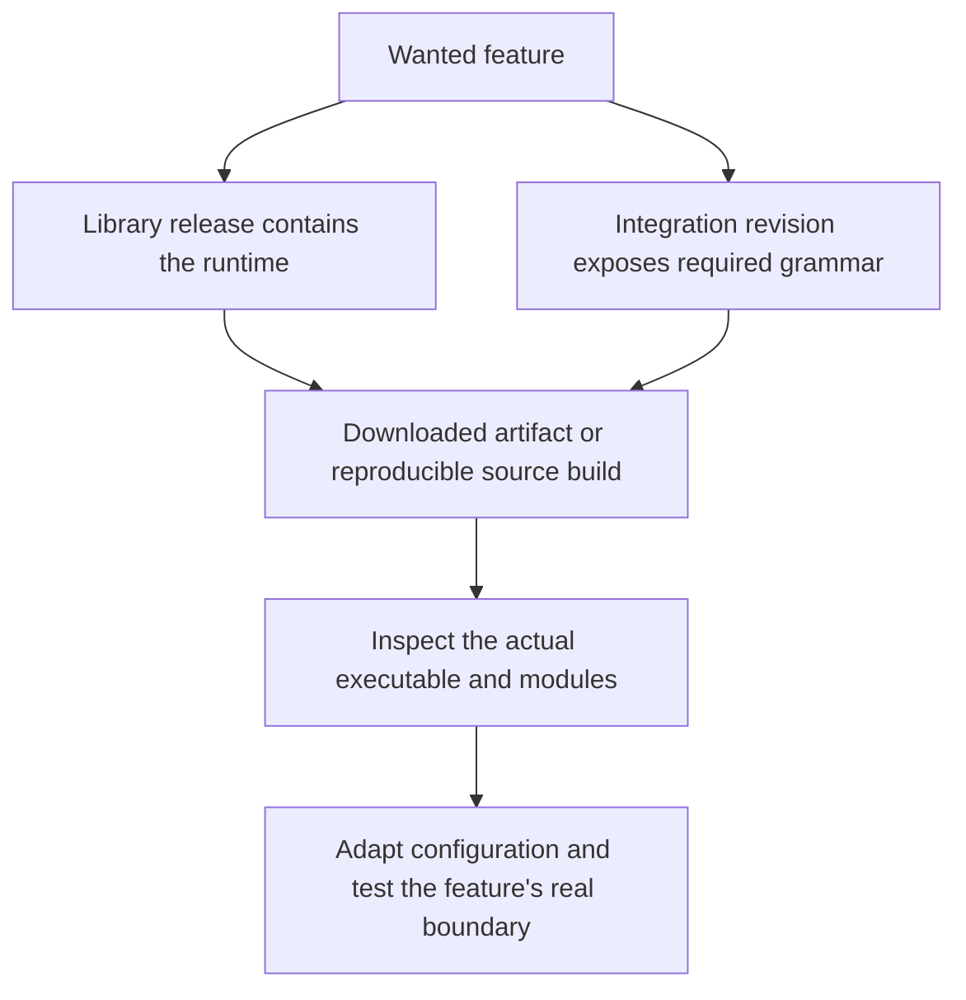

# Feature availability and versions

As checked on **October 27, 2026** (America/New_York), current published releases
are **AuthCrunch v1.6.2**, **caddy-security v1.6.2** and **go-authcrunch v1.5.0**.
Both Caddy executables use Caddy v2.11.7 and library v1.5.0. Installing a newer
standalone library does not update an already built executable.

## Choose the artifact

| Artifact | Contents and evidence |
| --- | --- |
| [AuthCrunch v1.6.2 distribution](https://github.com/authcrunch/authcrunch/releases/tag/v1.6.2) | Ready-to-run `authcrunch`; the three embedded portal apps and all 17 backend companions. [Pinned dependencies](https://github.com/authcrunch/authcrunch/blob/v1.6.2/go.mod) and [compiled imports](https://github.com/authcrunch/authcrunch/blob/v1.6.2/main.go). |
| [caddy-security v1.6.2](https://github.com/greenpau/caddy-security/releases/tag/v1.6.2) | Core `authcrunch` executable with the three apps and separate `caddy-authenticator` archives; backend companions require explicit imports/custom-build selection. [Dependency declaration](https://github.com/greenpau/caddy-security/blob/v1.6.2/go.mod). |
| [go-authcrunch v1.5.0](https://github.com/greenpau/go-authcrunch/releases/tag/v1.5.0) | Reusable runtime library with embedded app assets and mount-aware routing; its version alone does not prove a Caddy directive or plugin is compiled. |

All three have published release assets. The two server releases use the same
archive filenames; verify the checksum from the **same repository** as the
download. Follow [installation](../start/install.md) and the
[companion inventory](backends.md). Older provider examples retain their stated
v1.3.0/v1.3.8 test baseline where no new provider-specific runtime check was made.



## Check the executable you run

```sh
authcrunch version
authcrunch security version
authcrunch list-modules --versions
```

These report Caddy, the linked AuthCrunch library, and compiled modules. Also
retain the integration version/build provenance. For custom `caddy` builds use
that executable's name. The caddy-security v1.6.2 macOS arm64 archive was
checksum-verified for the [application setup](../apps/portal-apps.md), and
reported Caddy v2.11.7 and go-authcrunch v1.5.0. The older v1.5.0 distribution's
macOS arm64 archive was separately verified for the earlier companion review.

## Portal apps in v1.6.2

The executable embeds [User Profile](../apps/user-profile.md),
[Security Manager](../apps/security-manager.md), and
[File Vault](../apps/file-vault.md). The portal supplies links according to
feature availability and role. Security Manager needs the Admin API and
`authp/admin`; File Vault needs an initialized Documents API and a portal
user/admin role. Profile shell access does not replace its API/session checks.
Use the [complete setup](../apps/portal-apps.md) for configuration and role tests.

App assets, fonts, translations and lazy-loaded routes follow root and nested
portal mounts. Deep-link reloads retain the canonical app base. Missing asset
files return 404 rather than SPA HTML; explicit escaped mounts are preserved.
The UI's own version, such as v1.1.4 in the supplied File Vault demo, is separate
from the integration and linked library versions.

## Current feature map

| Capability | Availability and documentation |
| --- | --- |
| Local/LDAP/OAuth/SAML login, local MFA, direct OAuth, downstream OIDC | Core; existing guides retain their specified version/test boundaries |
| Typed policy-local ACL fields and corrected unconditional rules | Present in released v1.4.1 and v1.5.0; older v1.3.0 has the [unconditional-rule limitation](../authorize/acl-rbac.md#match-any-condition) |
| Cross-device login | Released, HTTPS and explicit opt-in; [approval flow](../authenticate/cross-device.md) |
| SQLite password accounts and email-confirmed signup | Selected companions; [provisioning and signup](../authenticate/local/sqlite.md) |
| Trusted application tickets | SQLite/Consul companions; [ticket protocol](../authenticate/ticket-login.md) |
| Durable notification outbox and secret snapshots | Selected companions; [messaging](../messaging/intro.md#sqlite-outbox), [secrets](../credentials/intro.md#sqlite-and-consul-secrets) |
| Fresh standalone API-key backends | SQLite/Consul companions; [API-key authentication](../authorize/api_key_auth.md#sqlite-api-keys) |
| Required request-time ACL attributes and HTTP decisions | Selected companions; [enrichment](../authorize/claims-enrichment.md), [external authorization](../authorize/external-authorization.md) |
| Selected PS256 signer and strict access-token profiles | Companion plus explicit consumer profiles; [signing and rotation](../authorize/access-token-profiles.md) |
| Shared pending upstream OAuth transactions | SQLite/Consul companions plus provider namespace; [login storage](../authenticate/oauth/login-storage.md) |
| Managed refresh storage and provider snapshot renewal | Named SQLite/Consul storage requires root state; OAuth renewal is explicit snapshot mode; [refresh guide](../authenticate/30-refresh-token.md) |
| Durable local attachments and user-confirmed account connection | Core plus explicit built-in-local-store target; [connected accounts](../authenticate/connected-accounts.md) |
| Encrypted Documents API | Core, explicitly enabled, current local browser session; [Documents](../authenticate/api/documents.md) |
| Built-in User Profile, Security Manager and File Vault apps | Bundled in v1.6.2 with go-authcrunch v1.5.0; [setup and walkthroughs](../apps/portal-apps.md) |
| Explicit mounts, independent tab destinations and portal/OIDC localization | Core; [mounts](../authenticate/auth-portal.md#explicit-portal-mounts), [redirects](../authenticate/100-trust-login-logout.md), [language](../authenticate/12-i18n-internationalization.md) |
| Standalone native login client | Separate caddy-security release asset; [caddy-authenticator](caddy-authenticator.md) |

## Earlier v1.5.0 upgrade baseline

The following notes retain the previous review's v1.5.0 baseline. For the app
addition, also review [v1.5.0 to v1.6.2 integration changes](https://github.com/greenpau/caddy-security/compare/v1.5.0...v1.6.2)
and [v1.4.1 to v1.5.0 library changes](https://github.com/greenpau/go-authcrunch/compare/v1.4.1...v1.5.0).
Select matching versions for any custom-build companions.

1. Download the intended artifact and inspect its modules; custom builds select
   every needed companion at v1.5.0. Importing the root alone no longer suffices.
2. Read the [integration changes](https://github.com/greenpau/caddy-security/compare/v1.4.1...v1.5.0)
   and [library changes](https://github.com/greenpau/go-authcrunch/compare/v1.3.11...v1.4.1).
   V1.5.0 includes both library v1.4.0 and v1.4.1 changes.
3. Back up coherent identities, keys and state. Persistent roots and overlapping
   local identity files require a drained stop/start, not an overlapping reload.
4. Adapt the actual configuration with the replacement executable, then test
   login, required factors, allowed/denied requests, logout, renewal and restart.
   Use explicit mounts for new portal integrations. Unknown UI languages now fail.
5. Check current credential changes: portal-backed Basic/API-key authentication
   rechecks the account on every request. Signed JWTs retain their own expiry.
   Authentication diagnostics add portal/realm attribution and redact raw
   provider identities; separately configure host-log credential redaction.

The release also fixes authorization reload hangs involving downstream streams
such as WebSockets, and SQLite ticket/refresh locking under contention. These
fixes do not make persistent overlapping reload supported. Upstream build
qualification uses Go 1.26.10 and `golang.org/x/net` v0.60.0; Caddy remains
v2.11.7. Source builds should retain those dependency/toolchain fixes rather
than inferring patch status from Caddy's version alone.

## Remaining boundaries

[AWS application SAML](../apps/sso_saml.md) still has an incomplete assertion
handler. [Native Nextcloud login](../authenticate/oauth/81-backend-oauth2-0014-nextcloud.md)
still lacks its profile integration. These are distinct from supported upstream
SAML and generic OIDC login.

Consul distributes selected backend records, not all portal authority. Managed
refresh still requires exclusive root state; independent roots cannot share
refresh authority. Sandbox/MFA, cross-device, downstream OIDC and direct-policy
session state retain their owners. See [deployment boundaries](backends.md).

## Agentic Prompts

Copy a prompt into your LLM to explore this topic. Each prompt prioritizes
upstream repository guidance and code over this page, and asks for version-aware
reasoning.

<div className="agentic-prompts">

<details>
<summary>Inventory the executable I actually run</summary>

```text
Help me understand Feature availability and versions.

Primary authorities (take precedence over website documentation):
https://github.com/greenpau/caddy-security/blob/main/AGENTS.md
https://github.com/greenpau/caddy-security/tree/main/.codex/skills
https://github.com/greenpau/go-authcrunch/blob/main/AGENTS.md
https://github.com/greenpau/go-authcrunch/tree/main/.codex/skills
Read each repository's root AGENTS.md first, then any scoped AGENTS.md that
applies to inspected paths. Read the relevant SKILL.md files and follow their
implementation and test references.

Relevant skills to locate: release-and-versioning, configuration.

Secondary reference:
https://docs.authcrunch.com/docs/operations/versions

If a source is inaccessible, ask me to paste its relevant text. Identify the
versions your answer applies to; main may be newer than my release. Resolve
disagreements using code and tests, and flag unverified claims. Use synthetic
credentials and redacted examples; explain proposed checks before any changes.

Ask for the binary path, Caddy version, security version, compiled modules,
and integration build provenance. Explain what each proves and what it cannot
prove. Distinguish a downloadable bundle, a source tag, a library module
release, and the source currently checked out beside the docs.
```

</details>

<details>
<summary>Verify a feature’s release boundary</summary>

```text
Help me understand Feature availability and versions.

Primary authorities (take precedence over website documentation):
https://github.com/greenpau/caddy-security/blob/main/AGENTS.md
https://github.com/greenpau/caddy-security/tree/main/.codex/skills
https://github.com/greenpau/go-authcrunch/blob/main/AGENTS.md
https://github.com/greenpau/go-authcrunch/tree/main/.codex/skills
Read each repository's root AGENTS.md first, then any scoped AGENTS.md that
applies to inspected paths. Read the relevant SKILL.md files and follow their
implementation and test references.

Relevant skills to locate: release-and-versioning, configuration.

Secondary reference:
https://docs.authcrunch.com/docs/operations/versions

If a source is inaccessible, ask me to paste its relevant text. Identify the
versions your answer applies to; main may be newer than my release. Resolve
disagreements using code and tests, and flag unverified claims. Use synthetic
credentials and redacted examples; explain proposed checks before any changes.

Choose a capability I want, then trace its adapter grammar, library consumer,
tests, release tags, and downloadable assets. Compare main with my exact
release. Mark source-only behavior explicitly and do not infer supported
syntax merely because the library exposes a related type.
```

</details>

<details>
<summary>Read release evidence critically</summary>

```text
Help me understand Feature availability and versions.

Primary authorities (take precedence over website documentation):
https://github.com/greenpau/caddy-security/blob/main/AGENTS.md
https://github.com/greenpau/caddy-security/tree/main/.codex/skills
https://github.com/greenpau/go-authcrunch/blob/main/AGENTS.md
https://github.com/greenpau/go-authcrunch/tree/main/.codex/skills
Read each repository's root AGENTS.md first, then any scoped AGENTS.md that
applies to inspected paths. Read the relevant SKILL.md files and follow their
implementation and test references.

Relevant skills to locate: release-and-versioning, configuration.

Secondary reference:
https://docs.authcrunch.com/docs/operations/versions

If a source is inaccessible, ask me to paste its relevant text. Identify the
versions your answer applies to; main may be newer than my release. Resolve
disagreements using code and tests, and flag unverified claims. Use synthetic
credentials and redacted examples; explain proposed checks before any changes.

Compare a version file, go.mod selection, release notes, a Git tag, and an
attached executable/checksum. Explain why a tag without published assets is
not a downloadable upgrade and why updating a source dependency does not
update an existing binary. Verify current official release information before
recommending a version.
```

</details>

<details>
<summary>Plan a reproducible upgrade check</summary>

```text
Help me understand Feature availability and versions.

Primary authorities (take precedence over website documentation):
https://github.com/greenpau/caddy-security/blob/main/AGENTS.md
https://github.com/greenpau/caddy-security/tree/main/.codex/skills
https://github.com/greenpau/go-authcrunch/blob/main/AGENTS.md
https://github.com/greenpau/go-authcrunch/tree/main/.codex/skills
Read each repository's root AGENTS.md first, then any scoped AGENTS.md that
applies to inspected paths. Read the relevant SKILL.md files and follow their
implementation and test references.

Relevant skills to locate: release-and-versioning, configuration.

Secondary reference:
https://docs.authcrunch.com/docs/operations/versions

If a source is inaccessible, ask me to paste its relevant text. Identify the
versions your answer applies to; main may be newer than my release. Resolve
disagreements using code and tests, and flag unverified claims. Use synthetic
credentials and redacted examples; explain proposed checks before any changes.

Create a plan to verify artifact provenance, required modules, redacted
configuration adaptation, trusted HTTPS, allowed and denied journeys, and
rollback constraints. Include local identity and persistent-state ownership
where applicable. Ask about topology and current versions before prescribing
commands or a deployment method.
```

</details>

<details>
<summary>Practice version diagnosis</summary>

```text
Help me understand Feature availability and versions.

Primary authorities (take precedence over website documentation):
https://github.com/greenpau/caddy-security/blob/main/AGENTS.md
https://github.com/greenpau/caddy-security/tree/main/.codex/skills
https://github.com/greenpau/go-authcrunch/blob/main/AGENTS.md
https://github.com/greenpau/go-authcrunch/tree/main/.codex/skills
Read each repository's root AGENTS.md first, then any scoped AGENTS.md that
applies to inspected paths. Read the relevant SKILL.md files and follow their
implementation and test references.

Relevant skills to locate: release-and-versioning, configuration.

Secondary reference:
https://docs.authcrunch.com/docs/operations/versions

If a source is inaccessible, ask me to paste its relevant text. Identify the
versions your answer applies to; main may be newer than my release. Resolve
disagreements using code and tests, and flag unverified claims. Use synthetic
credentials and redacted examples; explain proposed checks before any changes.

Quiz me on five mismatches: new docs with an old bundle, new library with an
old adapter, a release tag without assets, an executable on a different PATH,
and a locally replaced module. Wait for my evidence and show how to resolve
each without claiming a version check exercises the feature.
```

</details>

</div>

## Source Code References

Start with the code search, then follow the parser, runtime, and tests relevant
to this topic. These links target `main`; use GitHub's branch/tag selector to
compare them with your installed release.

1. [Search this topic in both repositories](https://github.com/search?q=%28repo%3Agreenpau%2Fgo-authcrunch%20OR%20repo%3Agreenpau%2Fcaddy-security%29%20%28GetVersion%20OR%20go-authcrunch%20OR%20CaddyVersion%29&type=code)
   — searches topic-specific symbols and paths across both codebases.
2. [caddy-security: go.mod](https://github.com/greenpau/caddy-security/blob/main/go.mod)
   — records the integration's selected Caddy and AuthCrunch library dependencies.
3. [caddy-security: command_security.go](https://github.com/greenpau/caddy-security/blob/main/command_security.go)
   — registers security commands, including the library-version report.
4. [caddy-security: command_security_version_e2e_test.go](https://github.com/greenpau/caddy-security/blob/main/command_security_version_e2e_test.go)
   — checks the security version command through the executable boundary.
5. [go-authcrunch: VERSION](https://github.com/greenpau/go-authcrunch/blob/main/VERSION)
   — records the library version in the selected source revision.
6. [go-authcrunch: go.mod](https://github.com/greenpau/go-authcrunch/blob/main/go.mod)
   — records the library's module and dependency declarations.
